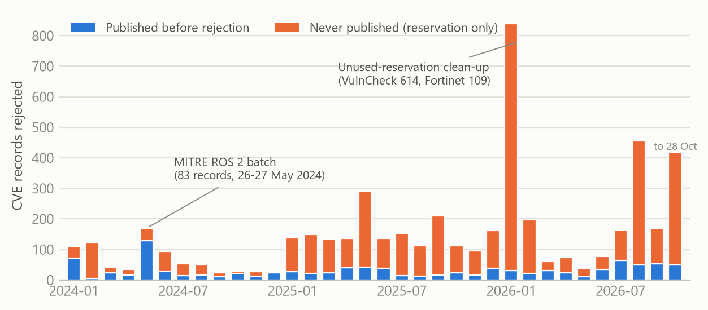
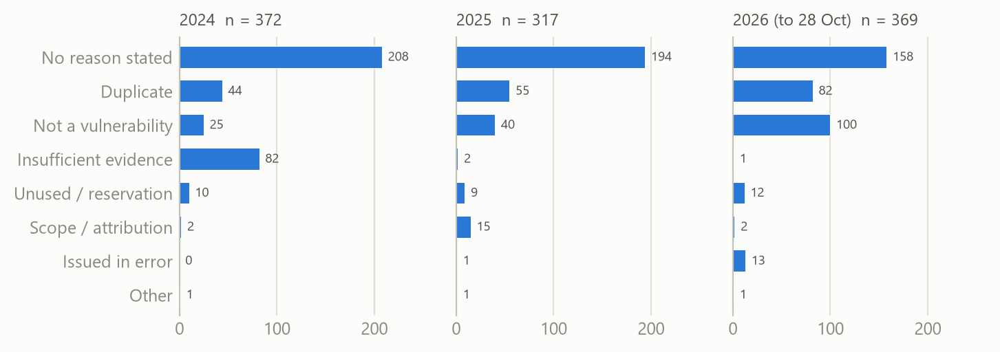
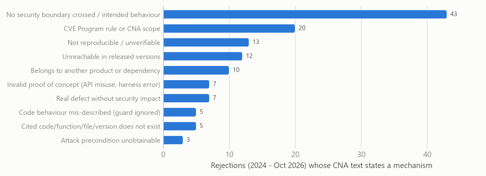
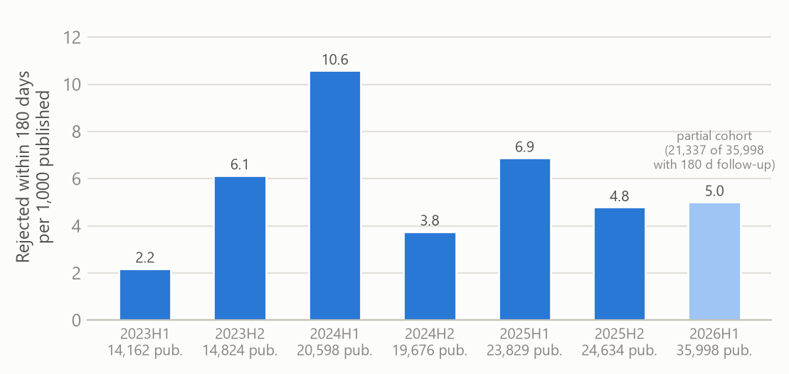
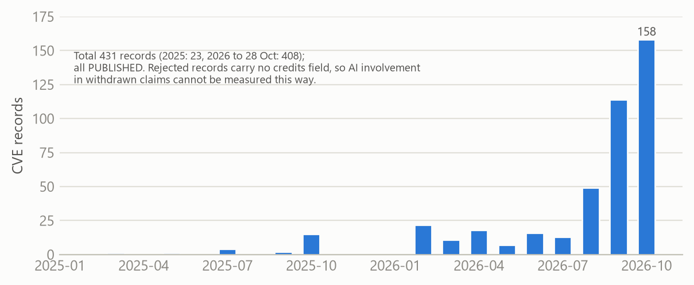
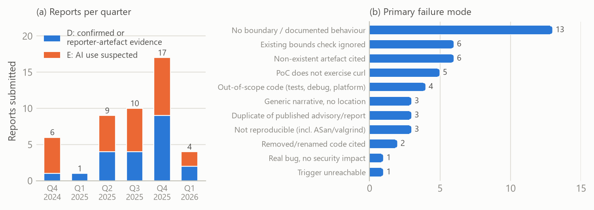
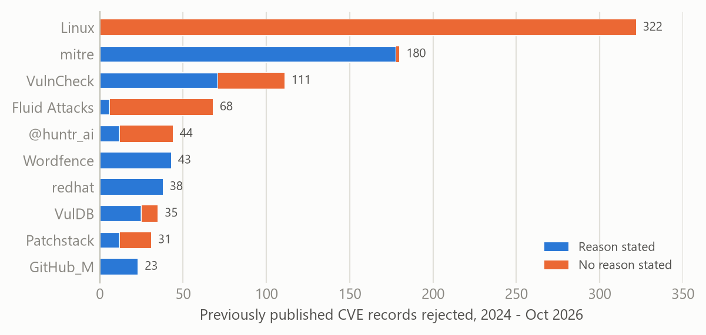

# When Vulnerabilities Aren't Real

**An Empirical Investigation into False, Rejected, and AI-Associated CVE Reports During the Generative AI Era (2024-2026)**

**Research period:** January 2024 - October 2026  
**CVE dataset snapshot:** 29 October 2026

# Abstract

We investigate CVE records and vulnerability submissions rejected, disputed or shown to be technically invalid between 1 January 2024 and 28 October 2026, and ask whether generative AI contributed. From the cvelistV5 snapshot of 29 October 2026 we classify all 5,115 rejections, including 1,058 withdrawals of published records, and 340 disputed records; code 49 curl HackerOne reports publicly labelled AI "slop" against git history and re-tested their claims in network-isolated containers, as recorded in the original investigation (Section 3.6); and examine twelve cases in depth, eleven verified against source code or release artefacts. These include six records that SQLite lists as unreproducible, from a July 2026 batch of 76 MITRE-assigned identifiers; for five we confirmed that the cited code does not exist, and the rest of the batch was not individually verified.

Official records say almost nothing about AI: no rejection reason mentions it, one disputed record quotes an allegation, and rejection deletes descriptions and credits. Before withdrawal, 63% (95% CI 55-71%) of a random sample of withdrawn records without a specific rationale had already been scored downstream. At least 431 published records credit an AI system as finder or tool, a classification-dependent lower bound rather than a count of AI-discovered vulnerabilities. AI involvement is indicated in 21 of 47 in-window reports on curl's maintainer-curated list, as recorded by the original investigation: 13 reporters disclosed AI use in the public report text (9 describe help with analysis, search, proof-of-concept code or report generation, and 4 describe use limited to writing, formatting, documentation or severity estimation), 5 further reporter admissions are recorded from comment threads that are not accessible here and were not independently re-verified, and 3 reports are attributed from chatbot residue in the reporter's own text, which is not confirmation by the reporter (two public examples are identified in Section 4.8). This counts AI involvement, not AI-generated technical claims; we verified that nine cite code that does not exist or existed only in another version. In the original investigation's recorded testing and source analysis, none of the 49 established a new vulnerability by its own mechanism. In the original investigation's classification of its documented findings (not independently reproduced), the headline claims of 31 reports were contradicted or not demonstrated (R-REF), 9 reproduced documented or designed behaviour with no vulnerability demonstrated (R-DOC), 5 depended on artificial, unreachable or contract-violating conditions (R-ART), 2 restated published CVEs (R-DUP), 1 was a real non-security defect (R-DEF) and 1 could not be adequately assessed (R-BLK); the reports in the first three groups are not all technically disproven. Yet the commonest failure, as in CVE rejections generally, is that no security boundary is crossed. Half-year cohort rejection rates (2.2-10.6 per 1,000 records within 180 days) show no monotonic increase and count rejections for any reason, not technical invalidity: the data do not show that AI has raised the CVE rejection rate. We assembled a structured dataset (not published in this edition), a verified mechanism taxonomy and a measurement argument: CVE status data cannot measure AI-generated false reporting.

*Research provenance and disclosure. The study used AI-assisted tools for source collection, technical investigation, experimental execution and drafting under researcher direction. In the curl audit (Section 3.6), report assessments were carried out by automated investigators, with internal AI-assisted review of the recorded verdicts. These assessments did not receive independent human technical validation. This publication includes the paper, concise curl case summaries, 46 detailed verdicts and ten Docker directories that have not been rebuilt or rerun for publication; the full datasets, run logs and code used in the original investigation (other than the files in those Docker directories) are not included. See Appendix A for the resulting verification limits.*

**Keywords:** CVE, vulnerability disclosure, rejected CVE, disputed CVE, large language models, hallucination, AI slop, bug bounty, CNA, data quality

# 1. Introduction

The Common Vulnerabilities and Exposures (CVE) system is the shared naming layer of vulnerability management. CVE Numbering Authorities (CNAs) publish records under common rules \[1\], \[2\], \[3\] that scanners, advisories and the National Vulnerability Database (NVD) consume largely on trust. That trust is under strain: the CVE Program reports 40,077 published records in 2024, 48,244 in 2025 and 72,812 in the first three quarters of 2026 \[4\] (a figure from a metrics page that could not be re-read for this edition and is not directly comparable with the snapshot counts in Section 4.5); NIST reports a 263% increase in CVE submissions between 2020 and 2025 and, from April 2026, enriches only a prioritised subset of new CVEs \[5\], \[6\]; and the contract under which MITRE operates the programme nearly lapsed in April 2025 \[7\], \[8\].

Generative AI adds pressure from two directions. Maintainers report floods of plausible but fabricated reports \[9\], \[10\], \[11\], \[12\], and the CVE Program's July 2026 forum on AI-enabled discovery recorded hallucinations, duplicates and polished-but-invalid reports as a growing burden \[13\]. Meanwhile AI systems find real vulnerabilities at scale (Section 2.5), and a 2026 pilot lets frontier AI laboratories act as CNAs subject to reproducible-evidence and human-validation requirements \[14\], \[15\].

The debate, often anecdotal, routinely conflates *rejected* records (possibly unused reservations or duplicates), *disputed* records (disagreement, not proven invalidity) and *AI-generated* reports (which may be correct). We keep these apart and ask what the public record can support.

**Research questions.** RQ1: Which CVE records and vulnerability submissions were found invalid between January 2024 and October 2026? RQ2: Why were they considered invalid? RQ3: What technical evidence supports their invalidity? RQ4: Were any demonstrably AI-generated? RQ5: What distinguishes AI-generated reports from ordinary researcher error? RQ6: How do invalid submissions affect maintainers, CNAs and databases? RQ7: Can the evidence support conclusions about change in false reporting in the generative AI era?

**Hypotheses.** H1: some 2024-2026 rejected CVE records correspond to demonstrably invalid technical claims. H2: documented AI-generated submissions exhibit recurring technical failure mechanisms. H3: official CVE rejection status is insufficient to measure the prevalence of AI-generated false reporting. H4: public evidence may be insufficient to determine whether AI has increased the overall rate of invalid submissions.

**Contributions.** (1) A dataset of all 5,115 CVE rejections dated 1 January 2024-28 October 2026, with a reason taxonomy (Appendix B), timing measures, cohort-adjusted rates and single-coder mechanism coding wherever a rejection states one. (2) A coded corpus of 49 maintainer-labelled AI-slop reports to curl with complete public threads, every code-level claim checked against repository history at the time of the report and every testable claim recorded as re-run against the curl version it targeted (original investigation; logs not published). (3) Independent source-level verification of eleven cases, including CVE records rejected for citing non-existent code. (4) A measurement of how AI involvement is, and is not, recorded in CVE data. (5) An evidence audit of the study's weakest points.

# 2. Background and Related Work

## 2.1 CVE assignment, rejection and dispute

CNAs reserve identifiers and publish records within their scope; CNAs of Last Resort, chiefly MITRE, cover the rest. Since version 4.0 of the CNA Operational Rules (in force from 8 August 2024), unused identifiers *must* be rejected; under version 3.0 the Secretariat rejected unused reservations annually \[16\], \[17\]. Published records *may* be rejected when no vulnerability exists, the wrong identifier was used, or assignments duplicate or are merged, and a rejected published record must carry an explanation; this wording is unchanged through version 4.2.1, in force at the end of the window, and version 3.0 gave similar grounds \[1\], \[16\]. A rejected CVE JSON 5 record keeps only metadata (including `dateRejected`), `rejectedReasons` and optional `replacedBy` \[3\]; a disputed record stays PUBLISHED with the CNA tag `disputed` and an explanation \[1\]. Throughout the window the dispute policy set response deadlines and allowed escalation up the CNA's Root hierarchy; its July 2025 revision requires the record to be tagged while a plausible dispute is reviewed and makes the Top-Level Root's decision final, except in cases involving cross-hierarchy scope issues, which are adjudicated by the Council of Roots \[2\], \[18\]. "REJECTED" therefore mixes housekeeping with technical invalidation, and rejection deletes the description, references and credits, leaving the original claim only in history sources such as NVD's change history \[19\].

## 2.2 Invalid vulnerability claims before generative AI

Chen et al. found 5.46% of 99,934 CVE entries from 2002-2017 invalid (4.84% rejected, 0.62% disputed), with duplicates making up 56.91% of analysable rejections and "cannot replicate" the leading dispute reason \[20\]. Dong et al. found that only 59.82% of reports and CVE summaries matched NVD's product and version data \[21\]; others document field-level inconsistencies in NVD \[22\] and 20-71% label inaccuracy in vulnerability datasets \[23\]. Incentives also generate unwarranted CVEs: 11% of 339 CVEs claimed in fuzzing papers were invalid \[24\], and 34% of 1,803 claimed in academic papers were unconfirmed or disputed \[25\]. Weak validation and impact incentives thus produce invalid claims without AI: a baseline and a confounder.

## 2.3 LLMs, vulnerability detection and hallucination

Unaided LLM vulnerability verdicts are brittle: semantics-preserving renames changed model answers in 17-26% of cases \[26\], and on the de-duplicated PrimeVul benchmark a state-of-the-art model fell from 68.26% to 3.09% F1 \[27\]. Beyond general hallucination taxonomies \[28\], \[29\], code studies document invented APIs and repository-context conflicts \[30\], \[31\], and hallucinated package names (5.2-21.7% of recommendations) carry real security consequences \[32\]; accuracy-oriented evaluation rewards confident guessing over abstention \[33\]. Conversely, LLMs combined with program analysis remove most static-analysis false positives in industry \[34\], and agents find real bugs at benchmark scale \[35\], \[36\].

## 2.4 Bug bounties, incentives and "AI slop"

Rewards raise submission volume \[37\], misaligned incentives flood programmes with invalid reports \[38\], and LLM-based triage tends to *accept* them \[39\]. curl reported in 2024 that 66% of bounty reports were neither vulnerabilities nor ordinary bugs \[9\] and in 2025 that roughly 20% of submissions were AI slop and about 5% valid \[10\], then ended the bounty on 31 January 2026 \[11\]. A 2026 survey frames hallucinated vulnerability assessment as a reasoning failure \[40\]. No study we found links these accounts to the official CVE record or checks claims of fabrication against source code.

## 2.5 AI that finds real vulnerabilities

Big Sleep found an exploitable SQLite bug before release \[41\]. Heelan's o3 experiment found a real kernel bug in 8 of 100 benchmark runs, alongside 28 false-positive reports, a signal-to-noise ratio he put near 1:50 in the larger setting \[42\]. AIxCC systems found 54 of 63 synthetic and 18 real vulnerabilities \[43\]. CISA's "Quality Era" framework named AI-enabled discovery as a pressure on record quality \[44\].

# 3. Research Methodology

The design combines a census of official records with purposive case studies verified in depth. Statistics are descriptive; no inferential test is reported because the data are a census rather than a sample (Section 7 discusses what that licenses). All data were collected on 29 October 2026 (UTC); scripts were numbered in execution order in the original investigation, but they and the file `METHODS_AND_REPRODUCIBILITY.md` are not published in this edition (Appendix A).

## 3.1 Sources and collection

**CVE List.** We downloaded the cvelistV5 release `cve_2026-10-29_0100Z` (asset `2026-10-29_all_CVEs_at_midnight.zip.zip`, 646,074,965 bytes, SHA-256 `b1f3f808…defc61d11`) \[45\] and parsed all 416,267 records without unpacking them (397,425 PUBLISHED, 18,842 REJECTED), extracting state, assigner, `dateReserved`, `datePublished`, `dateRejected`, `dateUpdated`, CNA tags, the "disputed" marker, and, for rejected records, the English `rejectedReasons` and `replacedBy` (unpublished script 01).

**Original claims of withdrawn records.** Because rejection removes the description, we queried NVD's CVE Change History API \[19\]. The 256 prioritised targets were all case records, every previously published record with a specific rejection rationale, and a seeded random sample (n = 150, seed 42) of the remaining withdrawn published records. An earlier, unprioritised pass retrieved 81 more, giving 337 in total. The API's rate limit made a complete crawl of all 1,058 withdrawn records impractical (unpublished scripts 03 and 14).

**curl report corpus.** The curl maintainer's public list of "AI slop" submissions to the curl HackerOne programme (49 distinct report IDs; created 28 June 2025; its revision history shows the latest content revision on 27 January 2026, although the gist's `updated_at` metadata reads 28 October 2026) \[46\] defined the corpus. For each report the original investigation retrieved the public JSON and complete activity thread through HackerOne's anonymous GraphQL endpoint \[47\] (unpublished script 04). The public report text could be re-read for this edition; the comment threads could not.

**Source code and artefacts.** Read-only clones of curl (full history, 40,304 commits to 29 October 2026) \[48\], ngtcp2 and nghttp3 \[49\], OctoPrint \[50\], quay/claircore and quay/clair \[51\], GNU Bison and SafestClaw; the official GNU Bison 3.8.2 release tarball \[52\]; Linux kernel and glibc identifier queries through the Elixir cross-referencer API \[53\]; and vendor documentation (nghttp2 API reference, ROS REP 3) \[54\], \[55\]. No proof-of-concept, patch, binary or build step from any report was executed; verification consisted only of `git log -S`, `git grep`, `git show`, tag-ancestry checks and text extraction (scripts 06 and 06b and the verification log are not published in this edition; see Appendix A).

**Literature and incident evidence.** AI-assisted research tools (see the provenance statement) ran bibliographic and incident searches, recording only material fetched in the session. Every number used from that work was re-fetched and spot-checked by the author against the original page, PDF or repository (Section 7; the original literature-check records are unpublished, see Appendix A).

## 3.2 Inclusion rules and key definitions

A record is in the *rejection population* if `dateRejected` falls on or after 1 January 2024 and before the snapshot cut-off, regardless of the year in its identifier. The release asset is the 00:00 UTC export of 29 October 2026 (its latest change is stamped 00:01:44 UTC), so the last observed day is 28 October. A rejected record is *previously published* if `datePublished` exists and precedes `dateRejected`; otherwise it is a *never-published reservation*. The *disputed population* is every record carrying the CNA `disputed` tag or the legacy `** DISPUTED **` marker; the window subset uses `datePublished` because dispute dates are not recorded. 2026 is a partial year (301 days, 1 January-28 October); annualised figures are labelled as such.

## 3.3 Rejection-reason classification

Each rejection was assigned one *reason family* by ordered regular-expression rules applied to the CNA's own text (first match wins): DUPLICATE, INSUFFICIENT_EVIDENCE, NOT_A_VULNERABILITY, SCOPE_OR_ATTRIBUTION, UNUSED_RESERVATION, ISSUED_IN_ERROR, GENERIC_NO_REASON, OTHER (unpublished script 02; full rules in Appendix B). Rules were developed by reading all 371 distinct normalised reason templates in the window, then every distinct text within each family. This review made two corrections: because Splunk fills `replacedBy` with the placeholder `CVE-0000-0000` for unused reservations, only real identifiers there now count as evidence of duplication; and residual OTHER texts fell from 29 to 5. The families record what the CNA *stated*, not whether the statement is true.

## 3.4 Mechanism coding of specific rationales

161 window rejections give a rationale beyond boilerplate: family NOT_A_VULNERABILITY, INSUFFICIENT_EVIDENCE, SCOPE_OR_ATTRIBUTION or OTHER, text longer than 70 characters, and not one of five generic templates. For these, the author coded the stated *invalidity mechanism* with a twelve-code book (Table 3; unpublished script 07): no security boundary crossed (BOUNDARY), unobtainable precondition (PREREQ), code behaviour mis-described (MISREAD), non-existent artefact (FAB), unreachable in released versions (UNREACH), invalid proof of concept (POC), not reproducible (NOREPRO), third-party origin (THIRDPTY), programme rule or scope (RULES), defect without security impact (NONSEC), GENERIC and OTHER. The 93-record MITRE batch sharing one "not reasonable evidence" template was coded NOREPRO separately. Coding was single-coder; the original codebook and decisions were retained in the internal research materials, but these files are not included in the public edition.

## 3.5 Rates under right-censoring

Records published late in the window have had less time to be rejected. We therefore compute, per half-year publication cohort, the share of published records rejected *within 180 days of publication*, counting only records with a full 180-day follow-up before the snapshot (unpublished script 09). The partially observed 2026H1 cohort is flagged.

## 3.6 Coding the curl corpus

Each report and its full thread was coded on three axes.

- *Failure mode:* the codes of Table 3 plus GUARD (existing check ignored), STALE (removed or renamed code cited) and GENERIC (no concrete location).
- *AI evidence level:* L1 self-disclosed; L2 admitted in the thread; L3 chatbot residue in the reporter's own text; L4 asserted by a maintainer in the thread; L5 list inclusion only. L1-L3 map to category D, L4-L5 to category E. Within category D, L1 and L2 are direct confirmation by the reporter; L3 is strong reporter-artefact evidence, not confirmation by the reporter.
- *Technical validity.*

Every code-level claim was checked against the repository as it stood at the report date (original verification log, unpublished; see Appendix A). The two pre-2024 reports are kept for context and excluded from window statistics.

*Reproduction audit.* The original investigation reports that the 49 reports were re-tested on 4 November 2026, from a corpus assembled on 1 November. The documentation published in this edition supports that account only in tiers (Appendix A): 41 verdicts contain run-dated execution descriptions, 5 verdicts mainly describe source, document, historical or shared evidence, and 3 investigations are summarised in READMEs only. These are documentation categories, not proof that the recorded experiments were executed as described. One report (#2871792) named no testable target, so only the material it supplied was examined; it is one of the five. The static codes above were treated as prior claims to test, not as evidence.

- *Claim sheets (unpublished).* Each report's claim sheet separated the alleged defect, its reachability, its security impact and the asserted exploitability. Where a report gave no version, the version was inferred from the report date and cited line numbers and labelled as an inference.
- *Builds.* curl was built from commit-pinned source at the claimed version and, where it mattered, at master on the report date and at HEAD (`1ee6ccab`). Builds were release and sanitizer builds (AddressSanitizer, UndefinedBehaviorSanitizer, LeakSanitizer), with Valgrind where positive controls showed it could see the effect.
- *Isolation.* As recorded by the original investigation, each case ran in a fresh Docker container without network access (`--network none`) and under CPU, memory and process limits, against local test servers. One stress case (#3101127) is recorded as having run many server processes inside a single container; no verdict is published for that case and its README does not state this, so the disclosure could not be verified here.
- *Proofs of concept.* Reporters' proofs of concept were run as supplied where they could run. Any change was kept as a separate, labelled control.
- *Controls.* Positive controls showed that the instruments could detect the claimed effect. Some used deliberately modified curl builds, which were never used as evidence about curl itself.
- *Platform claims.* Claims about IBM i, AmigaOS and native Windows were tested on substitutes: host harnesses of the verbatim code, qemu PPC32, and mingw-w64 under Wine. Each verdict states the fidelity gap. A result on a substitute does not establish behaviour on the target platform; such cases carry the modifiers PLAT_UNTESTED or SUBSTITUTE in `cases/README.md`.

Each report received one primary classification of its headline security claim. These classify the documented findings of the original investigation and are not independently reproduced results (the codebook is in Appendix B.5):

- R-REF: claimed security mechanism contradicted or not demonstrated within the tested scope;
- R-DOC: behaviour reproduced as documented or designed, with no security vulnerability demonstrated;
- R-ART: claimed mechanism or impact requires artificial, unsupported, unreachable or contract-violating conditions;
- R-DUP: headline claim duplicates an already published CVE;
- R-DEF: reproduced defect without established security impact;
- R-BLK: insufficient evidence or environment to assess the headline claim.

Secondary observations are recorded separately and are not counted as reports. Each case also carries an evidence-strength field (contradicted, not demonstrated, reproduced as documented, reproduced only under artificial or contract-violating inputs) and testing modifiers (PLAT_UNTESTED, SUBSTITUTE, VER_INFERRED, README_ONLY, PUBLIC_HISTORY_ONLY).

In the curl reproduction audit, assessments were carried out by automated investigators under a common protocol. The pilot (#3470095), review of recorded findings and two additional experiments (#2912277 and \#3125820) were conducted within the same AI-assisted workflow. Review included source-code and recorded-output checks; it was not independent human validation. The public case summaries do not contain the raw execution logs (Appendix A), and no result in this edition has been independently reproduced.

## 3.7 Case selection and classification

Cases were selected for verifiability, not representativeness. Each had to fall in the window, have its original claim recoverable from a primary source, and allow the disputed point to be checked without running untrusted code. Together they span rejected and disputed records, CNA types and AI-attribution levels. Every case is classified on three independent axes:

- *CVE status:* B, rejected; C, disputed.
- *Technical validity:* A, confirmed invalid; valid; contested; F, insufficient evidence.
- *AI attribution:* D, directly confirmed AI involvement or strong reporter-artefact evidence (disclosure or admission; or chatbot residue in the reporter's own text); E, suspected; F, none or insufficient.

Rejection alone never yields A.

## 3.8 AI-mention and AI-credit scans

All 416,267 descriptions and rejection texts were screened for statements linking a *report* to AI generation, and all `credits` arrays for named AI systems (unpublished scripts 10 and 11). All 47 description hits and 472 credit hits (464 records) were reviewed manually. Credits were classified by rules recorded in unpublished script 11: an AI system or agent named as finder or tool (431 records); only a person, team or company whose name contains an AI term, such as a researcher "(ZeroPath)" or a member of a vendor's AI security team (15); ambiguous, such as a bare "Claude" (17); other (1). Only the first class is counted.

## 3.9 Ethics and safety

Only public material was collected. Reporter identities are omitted from the paper and datasets. Proofs of concept were executed only in the curl reproduction audit (Section 3.6), inside network-isolated containers against local builds and local test servers; no third-party system was probed. Reporter attachments were treated as untrusted and never run in place. Issues the audit observed in current curl that have not yet been reported to the curl project are withheld from this paper and the research package pending coordinated disclosure.

# 4. Dataset and Results

## 4.1 The rejection population

Between 1 January 2024 and the snapshot cut-off (00:00 UTC, 29 October 2026), 5,115 CVE records were rejected (Table 1). Most are housekeeping: 2,755 of the 4,057 never-published identifiers carry an unused-reservation reason, and individual CNAs create visible spikes, the largest a January 2026 clean-up by VulnCheck (614) and Fortinet (109) (Fig. 1). The analytically important subset is the 1,058 records that were *public* before withdrawal. Identifier years are a poor guide to timing: 47.4% of rejections carry an identifier year other than the rejection year, some dating back to 2000.

Table 1. CVE rejections by rejection year and prior publication (cvelistV5, 29 Oct 2026).

| **Rejection year**  | **All rejections** | **Previously published** | **Never published** | **2026 annualised (all / published)** |
|---------------------|--------------------|--------------------------|---------------------|---------------------------------------|
| 2024                | 786                | 372                      | 414                 | n/a                                   |
| 2025                | 1,833              | 317                      | 1,516               | n/a                                   |
| 2026 (1 Jan-28 Oct) | 2,496              | 369                      | 2,127               | ≈3,027 / ≈447                         |
| **Total**           | **5,115**          | **1,058**                | **4,057**           |                                       |

Table 1. CVE rejections by rejection year and prior publication (cvelistV5, 29 Oct 2026).

Fig. 1. Monthly CVE rejections, January 2024-October 2026, split by whether the record had been published before rejection. Annotated spikes are a disputed batch (ROS 2) and an administrative clean-up.

## 4.2 What rejection reasons say

For withdrawn published records, the commonest stated reason is *none*: 560 of 1,058 (52.9%) carry only a generic withdrawal sentence, including all 322 of the Linux kernel CNA's (Table 2, Figs. 2 and 7). Duplicates account for 181 (17.1%) and explicit "not a vulnerability" statements for 165 (15.6%). A further 85 (8.0%) cite insufficient evidence, almost all from one MITRE batch (5.7). "Not a vulnerability" rationales rose from 25 to 40 to 100 across the three years while generic ones fell from 208 to 158; a single batch contributes 32 of the 2026 total of 100 (5.12).

Table 2. Stated reason family. "All" counts every rejection; "Published" counts previously published records only.

| **Reason family**     | **2024** | **2025** | **2026** | **All** | **Published** |
|-----------------------|----------|----------|----------|---------|---------------|
| Unused reservation    | 173      | 1,152    | 1,461    | 2,786   | 31            |
| No reason stated      | 275      | 460      | 620      | 1,355   | 560           |
| Duplicate             | 131      | 115      | 181      | 427     | 181           |
| Not a vulnerability   | 102      | 74       | 188      | 364     | 165           |
| Insufficient evidence | 97       | 2        | 7        | 106     | 85            |
| Scope / attribution   | 3        | 25       | 16       | 44      | 19            |
| Issued in error       | 4        | 4        | 20       | 28      | 14            |
| Other                 | 1        | 1        | 3        | 5       | 3             |

Table 2. Stated reason family. "All" counts every rejection; "Published" counts previously published records only.

Fig. 2. Stated reason for rejecting previously published CVE records, by rejection year.

## 4.3 Mechanisms of invalidity stated by CNAs

Of 161 rejections with a specific rationale, 125 state a mechanism (Table 3, Fig. 3). The dominant mechanism is *mis-scoped security reasoning*, not fabrication: 43 (34%) cross no security boundary, because the attacker would already hold root, administrator or environment control or the behaviour is documented, intended or operator-configured. Next come programme rules (20), non-reproducibility (13), defects present only in unreleased code (12), third-party origin (10) and invalid proofs of concept (7). Only five rationales state that the cited artefact does not exist, all from 2025-2026 (Section 5).

Table 3. Invalidity mechanism stated in 161 specific rejection rationales (manual coding).

| **Mechanism**                                                   | **All** | **Published before rejection** |
|-----------------------------------------------------------------|---------|--------------------------------|
| No security boundary crossed / intended or documented behaviour | 43      | 33                             |
| CVE Program rule or CNA scope                                   | 20      | 9                              |
| Not reproducible / unverifiable                                 | 13      | 5                              |
| Not present in released versions (unreachable)                  | 12      | 9                              |
| Belongs to another product, vendor or dependency                | 10      | 4                              |
| Invalid proof of concept (API misuse, harness error)            | 7       | 7                              |
| Real defect without security impact                             | 7       | 4                              |
| Code behaviour mis-described (existing guard ignored)           | 5       | 5                              |
| Cited function/file/version does not exist where claimed        | 5       | 5                              |
| Attack precondition unobtainable                                | 3       | 1                              |
| Assertion without mechanism (generic)                           | 34      | 21                             |
| Administrative (other)                                          | 2       | 1                              |

Table 3. Invalidity mechanism stated in 161 specific rejection rationales (manual coding).

Fig. 3. Invalidity mechanisms stated in rejection reasons (n = 125 records stating a mechanism).

## 4.4 Timing and downstream enrichment

Published records were usually withdrawn quickly: a median of 14.9 days after publication, 61.9% within 30 days. Yet 5.1% survived more than a year, and CVE-2023-4010 stood for 1,121 days (5.6). Medians fell from 46.0 days (2024) to 14.9 (2025) and 7.2 (2026); the 2024 figure is inflated by the ROS 2 batch (17.8 days without it). Downstream systems act before withdrawal. The random sample of 150 (Section 3.1) was drawn from the 953 withdrawn published records that were neither case records nor given a specific rationale, so the estimates below apply to that frame, not to all 1,058:

- 95 (63.3%; 95% Wilson interval 55.4-70.6%) had received a CVSS score: 32 (21.3%) from NVD and 73 (48.7%) from the CNA or an ADP enricher such as CISA, 10 from both;
- 48 (32.0%) had NVD product (CPE) configurations;
- 15 (10.0%) carried a dispute note before rejection, 8 of them ROS 2 batch records.

## 4.5 Rates: have rejections increased?

Publication volume rose from 40,274 records first published in 2024 to 48,463 in 2025 and 88,863 in 2026 to date (our snapshot count; this figure and the CVE Program's 72,812 records for the first three quarters of 2026 in Section 1 come from differently defined or unverified populations that this edition cannot reconcile, and they must not be compared directly), so Table 4 normalises by half-year cohort with a fixed 180-day follow-up (Section 3.5; Fig. 4). The numerator counts every stated reason, including duplicates and administrative withdrawals, so these are rejection rates, not rates of technical invalidity. There is no monotonic trend. The 2024H1 peak of 10.6 per 1,000 reflects the ROS 2 batch and the Linux kernel CNA's first year. Of the batch's 83 identifiers (5.7), 78 were published in 2024H1 and rejected within 180 days; the Linux CNA accounts for another 83 such rejections. Removing both groups from numerator and denominator leaves residual rates of 3.1 (2024H1: 57 of 18,187 eligible records), 2.3, 4.3, 3.3 and 4.7 (2026H1, partial); exclusion lists were in `data/exclusions/` (unpublished script 23); neither is published in this edition. The residual drift is small, non-monotonic and confounded by changes in CNA composition and practice.

Table 4. Published records rejected within 180 days of publication, by half-year cohort. The last column removes the 83 ROS 2 batch identifiers listed on oss-security and all Linux CNA records from both numerator and denominator.

| **Cohort** | **Published** | **Eligible (180 d)** | **Rejected ≤180 d** | **Per 1,000** | **Per 1,000 excl. ROS 2 batch and Linux CNA** |
|------------|---------------|----------------------|---------------------|---------------|-----------------------------------------------|
| 2023H1     | 14,162        | 14,162               | 31                  | 2.2           | n/a                                           |
| 2023H2     | 14,824        | 14,824               | 91                  | 6.1           | n/a                                           |
| 2024H1     | 20,598        | 20,598               | 218                 | 10.6          | 3.1                                           |
| 2024H2     | 19,676        | 19,676               | 74                  | 3.8           | 2.3                                           |
| 2025H1     | 23,829        | 23,829               | 164                 | 6.9           | 4.3                                           |
| 2025H2     | 24,634        | 24,634               | 118                 | 4.8           | 3.3                                           |
| 2026H1     | 35,998        | 21,337               | 107                 | 5.0 (partial) | 4.7 (partial)                                 |

Table 4. Published records rejected within 180 days of publication, by half-year cohort. The last column removes the 83 ROS 2 batch identifiers listed on oss-security and all Linux CNA records from both numerator and denominator.

Fig. 4. Share of newly published CVE records rejected within 180 days, by half-year publication cohort; the 2026H1 cohort is only partly observed.

## 4.6 Disputed records

All 1,514 records with a dispute marker are PUBLISHED, and 1,512 use the JSON 5 `disputed` tag. Of these, 340 were published in the window (132, 138 and 70 by year), 1.9 per 1,000 records published; the 2026 count is right-censored, as later cohorts have had less time to attract a dispute. MITRE (251) and VulDB (74) account for 96%; both process third-party submissions rather than vendor self-reports. With dispute dates unrecorded (Section 3.2) and `dateUpdated` made uninformative by bulk updates, dispute *timing* cannot be measured from the CVE List.

## 4.7 How AI appears in the official record

AI is almost absent from the record of rejected and disputed claims. None of the 5,115 rejection reasons mentions AI, LLMs, hallucination or generated content. Of 47 current descriptions matching AI-generation phrases, 41 concern vulnerabilities *in* AI products and three are spurious matches. Of the remaining three:

- one, the disputed CVE-2026-16129, records an allegation that a *report* was AI-generated (5.10);
- one kernel record states that an AI-generated review found its (valid) bug \[56\];
- one notes AI-written code as the *cause* of a vulnerability.

By contrast, at least 431 published records credit a named AI system or agent as finder or tool. This is a classification-dependent lower bound, not a count of AI-discovered vulnerabilities: findings whose credits do not name an AI system are missed, and credits naming only a person, team or company with an AI-related name (15 records) or ambiguous ones (17) are excluded (Section 3.8). Of the 431, 23 were published in 2025 and 408 in 2026, including 158 in October 2026 alone (Fig. 5). Four CNAs (Apache, CIRCL, Mozilla and bcorg) account for 75.6% of them, so the trend largely reflects those CNAs' crediting practice as well as AI use. Rejected records cannot appear in it: their format retains no credits. *The record documents AI involvement for accepted findings and erases it for withdrawn ones.*

Fig. 5. Published CVE records whose credits name an AI system as finder or tool, by month of publication.

## 4.8 The curl AI-slop corpus

Forty-seven listed reports fall in the window (Fig. 6a): six in 2024Q4, then 1, 9, 10 and 17 per quarter through 2025, and four in January 2026. None follows the end of the bounty on 31 January 2026 \[57\]. All were closed: 40 as not applicable, 6 as spam and 1 as informative.

*AI attribution.* Category D covers 21 reports (44.7%), as recorded by the original investigation. The evidence behind that total differs in how far it could be checked for this edition:

- 13 reporter self-disclosures that appear in the public report text, which were verified against the public report bodies. Nine describe AI help with analysis, search, proof-of-concept code or report generation, and name tools such as DeepSeek R1, Gemini, ChatGPT or "an AI agent". Four describe AI use limited to writing, formatting, documentation or severity estimation. Category D therefore records AI involvement, not that the technical claim was AI-generated;
- 5 reporter admissions in comment threads, recorded by the original investigation. The threads are not accessible to this edition, and the admissions were not independently re-verified (the case READMEs record three of them: #3231321, #3400831 and #3506159; the paper's Section 5.4 adds #3125820; the fifth is not identified in the published material);
- 3 attributions from chatbot residue in the reporter's own text. Residue shows that generated text was pasted into a report, but it is not confirmation by the reporter and it is not proof that the underlying technical claim was AI-generated. Two examples can be identified in the public report bodies: #3418528, whose body opens with an assistant-style reply addressed to the user, and #3101127, whose body contains a reply offering a "refined, high-impact version" of the report that mentions maximising perceived risk. The example this paper previously cited, a pasted instruction to a chatbot in #3230082 \[58\], could not be found in the accessible public report body; the evidence cited may lie in a comment or attachment that was not accessible, and that attribution is treated as unverified. The published material does not record which three reports the original investigation counted, so the total of 21 is retained as recorded and has not been recalculated. If #3101127 was not among the original three, the public evidence would support one more residue case than the recorded total.

The other 26 rest on maintainer assertion: 20 asserted in the thread and 6 through list inclusion only. One reporter who declared no AI use was nonetheless judged an AI user.

*Failure modes.* As in CVE rejections, the commonest primary failure is no security boundary crossed (13), followed by:

- ignoring an existing bounds check (6);
- citing a non-existent artefact (6);
- proofs of concept that never call curl or misuse internal or printf-style APIs (5);
- code outside the security scope, such as test servers, debug builds and the OS/400 and AmigaOS ports (4).

Across all labels, 9 reports cite a function, file, constant, version, documentation statement or snippet that does not exist or existed only in another release, each confirmed in git history (Section 5).

*Outcomes.* Reporters rated 25 reports high or critical. Of the 47:

- 43 had headline security claims that were contradicted, not demonstrated, or dependent on documented, artificial or unreachable conditions (R-REF 29, R-DOC 9, R-ART 5). These are not all technically disproven (see below);
- 2 restated vulnerabilities published twelve and ten days earlier \[59\], \[60\];
- 1 identified a genuine non-security leak (R-DEF);
- 1 could not be adequately assessed (R-BLK).

*Execution.* The reproduction audit (Section 3.6) agrees with every outcome above. Of the 47 in-window reports:

- 29 R-REF: the headline mechanism was contradicted or not demonstrated within an explicit scope. Evidence strength is recorded per case: contradicted by positive evidence (cited code that does not exist, a guard, a source invariant), or not demonstrated by negative tests within a scope;
- 9 R-DOC: the behaviour was reproduced as documented or designed, and no vulnerability was demonstrated;
- 5 R-ART: the claimed mechanism or impact requires artificial, unsupported, unreachable or contract-violating conditions. In \#3459636 the cited copy overflows only for a buffer of at most 1 byte, which the function's contract excludes; every caller passes 256 bytes. In \#3400831 the NULL stream comes only from the reporter's own caller. In \#2819666 the format-string behaviour arises only when a caller passes untrusted text as the format, which the documented contract forbids, and no in-tree call site was found that does so. In \#3462525 the overflow arises only when a caller supplies a buffer too small for an intentionally unbounded sprintf-style function, and no in-tree caller exists. In \#3473182 direct truncation was observed, but unintended proxy selection was not demonstrated on any reachable path;
- 1 R-BLK, could not be tested: \#2871792 names no file, function or input, and the reporter's last reply has a template placeholder where the location belongs. What it did supply, a file that does not exist and a debugger trace whose values all appear in an earlier report, was refuted;
- the 2 duplicates (R-DUP) reproduced as CVE-2024-11053 and CVE-2025-14524, and the leak in \#3137657 (R-DEF) reproduced.

The two pre-2024 reports are both R-REF. The 43 in-window reports in the R-REF, R-DOC and R-ART groups are not all technically disproven. Their evidence differs in strength: some headline claims were contradicted by positive evidence (cited code that does not exist, a guard, or a source invariant checked with positive controls); some were not demonstrated by negative tests within a stated scope, and a failed reproduction does not prove that a variant is impossible; some reproduced documented or designed behaviour with no vulnerability demonstrated; and some reproduced a mechanism only under artificial, unreachable or contract-violating conditions. The evidence strength of each case is recorded in `cases/README.md`. Secondary observations, such as the size-mismatch behaviour in \#3470095 and the relationship of \#2905552 to CVE-2024-2004, are recorded separately and are not counted as reports. Several proofs of concept never exercise curl at all: their sanitizer evidence comes from stand-alone programs that re-implement the cited function (Sections 5.2 and 5.3).

The original investigation also recorded that a "slop" label does not certify the surrounding code. Report \#2912277 restated CVE-2024-11053 (R-DUP). The investigation additionally recorded one variant of that leak, a `.netrc` `machine` entry with neither login nor password, as still sending the first host's password on redirect in curl 8.11.1, the release current at the report date, and as no longer doing so from 8.12.0. No verdict, log or command for this variant is published in this edition and it was not independently re-executed, so it is a recorded observation, not an independently reproduced result. Reading the source gives partial support for a potential credential-propagation mechanism. At 8.11.1, `lib/netrc.c` returns success without credentials for a matched entry that names neither login nor password; `lib/url.c` then keeps the credentials stored from the first host and marks the connection as netrc-authenticated, and `lib/http.c` allows credentials to be sent after a cross-host redirect for such connections. Commit `0e120c5b`, first released in 8.12.0 and shipped for CVE-2025-0167, makes the parser treat a matched entry without credentials as no match. That change applies to any matched entry, but its title, its test and the CVE-2025-0167 advisory describe only the `default` form, so the narrower scope of that advisory does not establish that the `machine` form is covered. The recorded observation also appears to disagree with the CVE-2024-11053 advisory, which lists the "omits both login and password" condition and states that 8.11.1 and later are not affected; the follow-up fix `9fce2c55` documented there first shipped in 8.12.0. This edition has not resolved that disagreement. The reporter quoted the advisory's no-login condition for versions through 8.11.0 but neither tested nor claimed that it still leaked in 8.11.1. A second historical finding, a source-level observation about HTTP/2 header buffering beside report \#3125820, is described in Section 5.4.

*Maintainer effort.* The threads contain 283 comments, 193 of them by curl team members or other non-reporters; median time to first closure was 1.57 hours (IQR 0.60-5.19).

Fig. 6. curl HackerOne reports labelled AI slop by the maintainer: (a) submissions per quarter by AI-evidence category; (b) primary failure mode (n = 47).

Fig. 7. Top ten CNAs by withdrawn previously published records, and whether the rejection states any reason.

# 5. Technical Case Studies

Table 5 summarises the twelve cases investigated in depth. Each is classified separately on CVE status, technical validity and AI attribution. Source-level verification was read-only; commands and outputs were recorded in the original investigation's verification log and evidence directory, which are not published in this edition (Appendix A). For the five curl cases, the reproduction audit (Section 3.6) also recorded executing each claim; its results are given under *Execution*. These results are historical measurements recorded by the original investigation; their logs are not published and they were not independently reproduced for this edition.

Table 5. Case matrix (B = officially rejected; C = disputed; A = confirmed technically invalid; D = directly confirmed AI involvement or strong reporter-artefact evidence; E = AI involvement suspected; F = insufficient evidence).

| **\#** | **Record**                                  | **CVE status**    | **Technical validity**                                                             | **AI attribution**                 | **Decisive verification by this study**                                                           | **Confidence**               |
|--------|---------------------------------------------|-------------------|------------------------------------------------------------------------------------|------------------------------------|---------------------------------------------------------------------------------------------------|------------------------------|
| 5.1    | curl H1 \#3125832                           | no CVE            | A: invalid                                                                         | E (maintainer)                     | Cited function absent from full histories of curl, ngtcp2, nghttp3                                | High                         |
| 5.2    | curl H1 \#3418528                           | no CVE            | A: cited function and provenance contradicted; IBM i behaviour untested | D (chatbot residue)                | Named function absent; signature recombines neighbouring identifiers                              | High                         |
| 5.3    | curl H1 \#3506159                           | no CVE            | A: invalid (analysis covered nghttp2 1.59.0) | D (admitted; thread not accessible) | Quoted API guarantee is the opposite of nghttp2's documentation                                   | High                         |
| 5.4    | curl H1 \#3125820                           | no CVE            | A: quoted snippet matches no curl revision (README only; no detailed verdict) | D (admitted; thread not accessible) | Snippet combines identifiers removed in 2020 (`ed35d6590e`, 2020-05-02) and 2023 (`744dcf22fa`, 2023-03-30) | High                         |
| 5.5    | curl H1 \#3137657                           | no CVE            | Valid bug, not a vulnerability                                                     | E (contested)                      | Fix commit 13032ff75c authored on report day, committed next day (UTC)                                                             | High                         |
| 5.6    | CVE-2023-4010                               | B (2026-08-25)    | A: invalid                                                                         | F                                  | Function absent from Linux v2.6.39, v4.19, v5.15, v6.4 and v6.12 (sampled); real function differs | High                         |
| 5.7    | ROS 2 batch (83 CVEs)                       | B (2024-05-26/27) | F: unsupported                                                                     | F (templated text only)            | All 83 rejected; one configuration falls outside ROS REP 3's targets                              | Medium                       |
| 5.8    | CVE-2025-8733/8734                          | B (2025-11-03)    | A (8733); F (8734)                                                                 | F                                  | 8733's frames are glibc's; 8734's function exists only in generated code                          | Medium-High                  |
| 5.9    | CVE-2026-10517                              | B (2026-07-27)    | F: fetch behaviour real; PSK precondition misattributed; rejected as design choice | F                                  | Fetch and 256-byte echo are claircore code; no PSK code in claircore; PSK in clair                | High (attribution)           |
| 5.10   | CVE-2026-16129                              | C (disputed)      | Mechanism valid; impact contested                                                  | E (maintainer)                     | Allowlist accepted `env`; hardened seven days after report                                        | High (mechanism)             |
| 5.11   | CVE-2026-94489/94490                        | B (2026-10-13)    | A (version claim); partly verified                                                 | F                                  | Cited function first ships in 1.6.0, not 1.0.0                                                    | Medium                       |
| 5.12   | SQLite/ESP32-audioI2S/LibRaw batch (76 IDs) | B (2026-07-31)    | A (six SQLite-listed records; five verified here)                                  | E (maintainer + analyst inference) | Five fabrication markers confirmed in SQLite history                                              | High (SQLite-listed records) |

Table 5. Case matrix (B = officially rejected; C = disputed; A = confirmed technically invalid; D = directly confirmed AI involvement or strong reporter-artefact evidence; E = AI involvement suspected; F = insufficient evidence).

## 5.1 A function that never existed: curl report \#3125832 (HTTP/3)

*Claim and response.* Submitted on 4 May 2025 with a "high" severity rating, this report claimed that a modified aioquic server corrupts memory in curl 8.13.0 through HTTP/3 stream-dependency cycles. Its stack trace passed through `ngtcp2_http3_handle_priority_frame` \[61\]. The maintainers replied that the supplied patch did not apply, curl does not handle HTTP/3 priorities, and the named function does not exist in ngtcp2 or nghttp3. The reporter closed the report as not applicable about ten hours after submission; the maintainer then called it AI slop and disclosed it.

*Verification.* We searched the complete git histories of curl (40,304 commits), ngtcp2 and nghttp3 to 28-29 October 2026 with `git log --all -S`: no commit in any of the three has ever added or removed the string. HTTP/3 PRIORITY_UPDATE handling exists in nghttp3 (`lib/nghttp3_conn.c` and related files), consistent with the maintainer's account.

*Execution.* A real HTTP/3 build of curl was tested: 8.13.0, master at the report date and HEAD, with ngtcp2 and nghttp3 over GnuTLS. A test server sent PRIORITY_UPDATE frames in every encoding tested: on the control and request streams, in the push variant, and as a flood of 100,000. nghttp3 rejected each and closed the connection. Across 13 runs of an 8.13.0 sanitizer build there was no AddressSanitizer or UndefinedBehaviorSanitizer report. The reporter's server could not start; with two labelled fixes it started but never sent a frame.

*Assessment.* Category A, E (high). The stack trace is fabricated, not merely misattributed: it fuses two real library prefixes with HTTP/3 vocabulary, a recombination pattern that recurs in 5.2.

## 5.2 A recombined signature: curl report \#3418528 (OS/400)

*Claim.* Submitted 10 November 2025, the report alleged a stack buffer overflow from `strcpy` in a function declared as `static char *Curl_ldap_err2string(char *cp, char *cp2)`. It cited an AddressSanitizer frame at `packages/OS400/os400sys.c:741` \[62\]. The report body opens with a chatbot-style reply to its own user, promising a "professional" report for the submission form. This is artefact-based evidence of AI use in the reporter's own text (category D, chatbot residue), not an admission.

*Verification.* At the last commit before submission, `os400sys.c` defines `Curl_ldap_err2string_a(int error)` (line 712), which returns a thread-local string and contains no `strcpy`. Line 741 is blank. The nearest `strcpy(cp, cp2)` is line 742, inside `Curl_ldap_get_dn_a`, which copies an ASCII-converted string of identical length back into its original buffer. The invented signature's parameter names, `cp` and `cp2`, are exactly that neighbouring function's local variables.

*Execution.* `os400sys.c` is never compiled outside IBM i, which was not available. A host harness ran the verbatim wrapper code 202,530 times with inputs up to 1 MiB, under AddressSanitizer and UndefinedBehaviorSanitizer, without an error. The reporter's recorded AddressSanitizer trace came from a stand-alone 696-byte program that contains no curl code.

*Assessment.* Category A for the cited function and provenance (high); the behaviour of the IBM i code on IBM i was not tested. Category D (chatbot residue, verified in the public report body). The artefact is assembled from real tokens within thirty lines of each other (a nearby function name, line number and variable names).

## 5.3 A fabricated documentation quote: curl report \#3506159 (HTTP/2)

*Claim.* Submitted 10 January 2026, the report claimed that curl's `on_header` callback reads out of bounds, because the nghttp2 documentation, which it "quoted", warns that header names and values are *not* NUL-terminated, while curl formats them with `%s` \[63\].

*Verification.* The nghttp2 API reference for `nghttp2_on_header_callback` states the opposite: both `name` and `value` are guaranteed to be NUL-terminated \[54\]. curl then formatted them with `curl_maprintf("%s:%s", name, value)`, correct under that guarantee. The reporter's AddressSanitizer output came from a stand-alone program, not from curl.

*Execution.* curl was built at 8.18.0, at master on the report date and at HEAD, with libnghttp2 1.59.0, in release and sanitizer builds. The cited handler runs only when an application installs a server-push callback, which the reporter's command line does not. With a callback installed, no out-of-bounds read occurred. The reporter's server failed to start. Once corrected, its own HTTP/2 library refused to push, because the curl command line disables server push. The reporter's AddressSanitizer evidence came from a stand-alone program, not from curl.

*Assessment.* Category A (high; the analysis covered nghttp2 1.59.0) and D (admitted, as recorded by the original investigation; the thread is not accessible to this edition). In the thread the reporter attributed the false quotation to an AI translation and summarisation tool that "hallucinated" the passage: a factuality hallucination \[29\] about third-party documentation, which source-code review alone does not catch.

## 5.4 Anachronistic code: curl report \#3125820 (HTTP/2 CONTINUATION)

The report's "simplified" `lib/http2.c` excerpt \[64\] combines `h2->header_recvbuf`, removed from curl on 30 March 2023 (commit `744dcf22fa`), with `Curl_add_buffer_init`, removed on 2 May 2020 (commit `ed35d6590e`); both removal points were checked in curl's history for this edition. Neither identifier exists at curl-8_3_0 or curl-8_13_0, and curl's HTTP/2 source contains no CONTINUATION handling, which nghttp2 consumes internally. Category A (the quoted snippet matches no curl revision; only a README summary is published for this report and no detailed verdict). Category D (admitted): the reporter's later admission of combining AI into the audit and acknowledging its hallucinations is recorded by the original investigation, but the thread is not accessible to this edition and the README does not mention it. This is the STALE pattern, code from different eras presented as current (notes in the original verification log, unpublished; see Appendix A).

*Execution.* The audit tested curl 8.13.0, master at the report date and HEAD against a server sending a HEADERS frame and then endless CONTINUATION frames. Across 36 release-build cases (four frame patterns, three nghttp2 versions, three curl revisions) client memory stayed at or below 9.5 MB. Most cases ended when nghttp2 or curl's header cap rejected the stream; the one truly endless case was stopped after 20 seconds. nghttp2 never passes CONTINUATION frames to curl, and curl caps decoded headers at 300 KiB. The reporter's proof of concept could not start, and it sends DATA frames, not CONTINUATION frames.

The audit also recorded a different, historical condition, which this edition supports only at source level. In curl 8.3.0 to 8.6.0 the HTTP/2 filter wrote decoded response headers into a per-stream buffer created with a soft limit (`BUFQ_OPT_SOFT_LIMIT`), and the response-header size cap (`Curl_bump_headersize`, added in 8.3.0 for CVE-2023-38039) was applied only when the HTTP layer later parsed that buffer, so decoded headers were buffered before the cap was applied. From curl 8.7.0, after commit `0dc036225b` ("HTTP/2: write response directly", committed 2024-02-05, after 8.6.0), decoded headers reach the HTTP layer as they are decoded, where the cap is applied; that commit's message describes lower memory use on parallel transfers and does not mention the cap. The original investigation recorded memory growth from this condition and tied it to nghttp2 1.60 or earlier. Those measurements are not published, memory-exhaustion exploitability was not independently demonstrated, and the nghttp2-version dependency is not established by the available evidence. This is not presented as a proven vulnerability, and no claim is made about whether a CVE could cover the condition; a keyword search of curl's published vulnerability data found no entry describing it other than CVE-2023-38039, which introduced the cap. The buffering design did not apply to the release current at the report date, though it applied to 8.3.0, a version the report names. There was no curl 8.6.x release; 8.6.0 was the last release with this design.

## 5.5 Inside the slop list, a real bug: curl report \#3137657

This report described a memory leak in config-file (`-K`) parsing in `tool_getparam.c` \[65\]. curl traced it to `-h` in a config file, judged it a bug rather than a vulnerability, and fixed it promptly (commit 13032ff75c: report submitted 2025-05-09T20:18:25Z, fix authored 2025-05-09T21:43:22Z, 85 minutes later, and committed 2025-05-10T09:16:07Z; times from the public report and GitHub commit metadata). The maintainers considered the reporter's later patch in the thread hallucinated. *Execution:* the original investigation records the leak under LeakSanitizer and Valgrind at the reporter's apparent revision with the reporter's configuration. On curl 8.13.0 that configuration crashes before LeakSanitizer can observe the leak (a different bug), so the 8.13.0 leak was observed with a reduced `-h all` configuration. At the reporter's apparent revision it is exactly N·(L+1) bytes for N config-file lines `-h` with an L-byte argument. It occurs once, at start-up, in the curl tool but not libcurl. The reporter's root cause, `getstr()`, was wrong: every leak stack ends at the `strdup` of the help category. Valid bug, invalid vulnerability claim; AI attribution E (contested). A "slop" label judges a *report*, not the absence of a defect (original verification notes, unpublished; see Appendix A).

## 5.6 A CVE for a non-existent kernel function: CVE-2023-4010

*Claim.* Red Hat reserved and published the record on 31 July 2023, describing an endless loop in the Linux USB host-controller framework's `usb_giveback_urb()` function, triggered by a malformed descriptor (CWE-835). NVD scored it CVSS 3.1 4.6 (physical) on 4 August 2023 and tagged a third-party GitHub repository as an "Exploit" reference \[66\].

*Status history.* The record stayed PUBLISHED for 1,121 days. On 25 August 2026 the CNA rejected it, stating that the description attributes the vulnerability to a non-existent kernel function. The original description survives in NVD's change history and, as of 6 November 2026, in an OSV entry that is not marked withdrawn.

*Verification.* Through the Elixir API \[53\], `usb_giveback_urb` has zero definitions and zero references in Linux v2.6.39, v4.19, v5.15, v6.4 and v6.12. The real function `usb_hcd_giveback_urb` has a prototype and a definition (`drivers/usb/core/hcd.c`) and is referenced from 21-26 files in each version. We did not examine the third-party "exploit" repository's code, and nothing was executed.

*Assessment.* Category B+A (high confidence that the cited function does not exist). AI attribution F: the record offers no indicator. FAB is not unique to LLMs, and an invalid record can persist for years with a score, enterprise CPEs and an "exploit" reference.

## 5.7 Eighty-three unsupported records: the ROS 2 batch

*Claim.* Between June 2023 and April 2024 MITRE published 81 records attributing vague, high-level vulnerabilities, such as "unauthorized node injection", to Robot Operating System releases; two more identifiers were never published. On 22 April 2024 a Canonical engineer listed all 83 on oss-security \[67\], observing that:

- the descriptions supplied no evidence;
- ROS developers had not been contacted and doubted the claims;
- three records cited a paper whose technical part followed a ROS 2 beginner tutorial;
- at least one record described an implausible configuration.

MITRE had already tagged the records as disputed; for CVE-2024-29439, NVD history dates this to 17 April 2024. MITRE rejected all 83 on 26-27 May 2024 for lack of reasonable evidence \[68\]. Ten other never-published reservations (CVE-2024-31622 to CVE-2024-31631, reserved 5 April 2024) were rejected with the same text on 5 June 2024; their subject is unknown.

*Verification.* All 83 identifiers in the post are REJECTED in the snapshot with that rationale. For the implausible configuration, ROS REP 3 lists Python 2.7 as Kinetic Kame's minimum requirement and says Python 3.4 is "not required, but testing against it is recommended" \[55\]. The configuration named in the CVE-2024-30737 description, "ROS Kinetic Kame in ROS_VERSION 1 and ROS_PYTHON_VERSION 3", therefore lies outside Kinetic's targets: the post's "unlikely situation".

*Assessment.* Category B; validity F (unsupported, not disproved). We did not obtain the claimants' evidence or the full text of the cited paper. AI attribution F: the critic called the texts copy-pasted *or generated*, and templated wording alone cannot support attribution. The batch drives 2024's "insufficient evidence" rejections and the 2024H1 peak in Fig. 4.

## 5.8 Stack frames from another project: CVE-2025-8733 and CVE-2025-8734 (GNU Bison)

VulDB published two Bison records on 8 August 2025 and rejected both on 3 November, noting that the files in the stack traces do not exist in Bison \[69\]. For CVE-2025-8733 we confirmed this: the cited `__obstack_vprintf_internal` in `obprintf.c` is glibc code (Elixir) and appears nowhere in Bison's history. For CVE-2025-8734 we could *not*: `code_free` is absent from version control but present in the flex-generated `src/scan-code.c` of the official 3.8.2 tarball (`#define yyfree code_free`) \[52\]. Categories B+A and B+F respectively; AI attribution F. Repository-only searches can wrongly infer fabrication when generated code ships only in releases (original verification notes, unpublished; see Appendix A).

## 5.9 Real fetch code, misattributed precondition: CVE-2026-10517 (Clair)

Red Hat's SSRF record of 1 June 2026 described Clair's fetcher requesting attacker-supplied URIs when the optional PSK authentication is off and echoing up to 256 bytes of error bodies \[70\]. The record names Clair (Red Hat Quay); advisories GHSA-698x-9w2p-7vvp (GitHub) and GO-2026-5939 (Go) mapped it to the `quay/claircore` module. Red Hat retracted the record on 27 July after upstream review, stating that PSK authentication is implemented in `quay/clair`, not claircore, and that the unauthenticated indexer API is a documented, opt-in design choice. We confirmed that split: no claircore Go source mentions PSK, while clair documents PSK authentication and serves `/indexer/api/v1/index_report`, the endpoint the rejection names \[51\]. The described behaviour, however, is claircore code: its fetcher requests the descriptor URI (`libindex/fetcher.go`) and `CheckResponse` puts the first 256 bytes of a non-200 body into the error (`internal/httputil/responsechecker.go`). The rejection therefore rests on the precondition's location and Clair's threat model, not on the behaviour being absent. Category B; validity F (behaviour real, exploitability a documented deployment choice); the claircore attribution of the PSK precondition is wrong (high). Neither advisory had been withdrawn by 6 November 2026. AI attribution F (original verification notes, unpublished; see Appendix A).

## 5.10 Disputed, AI-alleged, and mechanically correct: CVE-2026-16129 (SafestClaw)

*Claim.* A GitHub issue opened on 12 June 2026 reported that SafestClaw's sandboxed shell could be bypassed through the allow-listed `env` wrapper (`env bash -c id`), because `_validate_command` checks only the first token \[71\]. The maintainer replied that the claim was correct on paper, but that nothing the reporter's AI had produced showed a threat to users. VulDB published CVE-2026-16129 on 18 July 2026 from a different submitter, tagged it `disputed`, and quoted the maintainer's AI remark \[72\].

*Verification.* At the last commit before the report, `DEFAULT_ALLOWED` contained `env` as well as the `python3`, `node` and `npm` interpreters, and `_validate_command` checked only `Path(args[0]).name`. The bypass is real, but the allowlist already admitted interpreters able to run arbitrary code, the substance of the maintainer's impact objection. Five days after the reply, commit ccb03b9 hardened the allowlist and introduced a `NEVER_ALLOW` list of shells, interpreters and command runners, enforced in sandboxed mode; a follow-up commit, e8dbbed, made that enforcement an operator opt-out that stays on by default \[73\]. Both commits list "Claude" as author and carry a Claude co-author trailer. The change first shipped in tag 4.2.5 (22 September 2026), consistent with the CVE's "up to 4.2.4" range.

*Assessment.* Category C (mechanism valid, impact contested); AI attribution E. This is the clearest counterexample in our set: a report dismissed as AI-generated was mechanically correct. The allowlist was hardened a week later, but the fix commit does not cite the issue, so we cannot establish that the report prompted the change.

## 5.11 The wrong version: CVE-2026-94489 and CVE-2026-94490 (OctoPrint)

VulDB published two records against "OctoPrint 1.0.0" on 21-22 September 2026 and rejected them on 13 October 2026 \[74\]. We confirmed the version error: `_validate` in `api/files.py` first appears in the 1.6.0 release line (tag 1.6.0rc1; first stable release 1.6.0), `executeSystemCommand` first appears at 1.3.0rc1, and 1.0.0 has no `api/` package \[50\]. We could not fully confirm the second premise, that traversal protection exists in every version. `_validate` leaves `..` components intact; containment relies on `sanitize_path`, which resolves paths and rejects any outside the base folder; route-level analysis was not performed. Category B; A for the version claim (high), not established for traversal (medium); AI attribution F (original verification notes, unpublished; see Appendix A).

## 5.12 Six fabricated SQLite records in a larger batch: CVE-2026-51229 to CVE-2026-51304

*Claim.* MITRE reserved 76 consecutive identifiers on 7 June 2026 and published 32 of them between 27 and 30 July 2026. The records described memory-safety flaws, several scored critical, in SQLite 3.41, the ESP32-audioI2S library and LibRaw \[75\]. Enrichment followed within a day: for CVE-2026-51302, NVD history shows CISA's ADP container adding CVSS 3.1 AV:N/AC:L/PR:N/UI:N/S:U/C:H/I:H/A:H (9.8) with an SSVC "proof of concept" exploitation flag on 28 July, and NVD attaching the CPE for SQLite 3.41.0 on 29 July. On 30 July the ADP downgraded the vector and set exploitation to "none".

*Responses.* SQLite lists six of the identifiers as not bugs in SQLite, stating that they are unreproducible and appear to be AI hallucinations \[76\]. SQLite's lead developer wrote that the analysed record was one of many dozen and that a random sample had found none valid; on 4 August he added that MITRE had made no attempt to contact the developers \[77\]. JFrog's analysis found that 54 of 55 advisories from the same account were fabricated and one wrapped a real bug in unverified metadata \[78\]. MITRE rejected all 76 identifiers on 31 July 2026 with the standard text that further investigation showed the issue was not a security issue, without mentioning fabrication or AI.

*Verification.* Using SQLite's git mirror \[79\] we confirmed five of JFrog's fabrication markers without running any proof of concept:

- `src/json.c` at version-3.41.0 has 2,706 lines, so the cited lines 3,555 and 3,575 cannot exist.
- `exprComputeOperands` does not occur at 3.41.0; it first appears in commit e24f20a4f5 of 30 June 2025.
- `jsonBlobEdit` is absent at 3.41.0 and present from 3.45.0, the JSONB release.
- `sqlite3ExprListDelete` takes `(sqlite3 *db, ExprList *pList)` at 3.41.0, not the single argument claimed.
- `src/expr.c` is byte-identical between 3.51.2 and 3.51.3, so the "fix" cited between those releases does not exist.

As of 29 October 2026 the OSV entry for CVE-2026-51302 was still not marked withdrawn, three months after rejection.

*Assessment.* Category B and A: high confidence for the five SQLite-listed records whose markers we verified, and A on SQLite's and JFrog's evidence for the sixth (CVE-2026-51300), whose cited lines we did not check. The other 70 identifiers, which include at least two further SQLite 3.41 records (CVE-2026-51290 and CVE-2026-51298), were not individually verified. AI attribution E: the maintainers assert it, the analyst infers it from detector output and fabricated references, and there is no admission. The SQLite-listed records are the clearest instance of the FAB and STALE mechanisms in a CVE batch, yet our pipeline classifies the batch only as "not a vulnerability", because that is all the official record says. The batch accounts for 76 of 2026's 188 "not a vulnerability" rejections, including 32 of the 100 previously published ones, and so explains much of that category's 2026 rise in Table 2.

## 5.13 Contrast cases: administrative and threat-model rejections

Two groups of rejections show why rejection counts overstate *technical* invalidity.

- **Node.js end-of-life records.** HackerOne's CNA published CVE-2025-23087-23089 in January 2025 to flag end-of-life Node.js versions. In March 2025 it rejected them as not compliant with the programme's assignment requirements \[80\]. The rules then in force did not yet say that end-of-life status alone is not a vulnerability; version 4.1.0 of 14 May 2025 added that \[81\]. SICK AG's rejection of CVE-2025-10561 (November 2025) applies it explicitly, calling end-of-life status a weakness rather than a vulnerability instance. Nothing about the underlying software was disproved.
- **Claude Code records.** VulnCheck's three 2026 records against the Claude Code CLI (CVE-2026-35020-35022) were rejected on threat-model grounds: control of environment variables, a code path unreachable in normal use, and documented flag behaviour \[82\].

These AI-*product* records belong to the BOUNDARY and UNREACH mechanisms and say nothing about AI-*generated* reports.

Disputes follow the same pattern. Table 6 lists contested records whose dispute basis we confirmed in the snapshot's record text or the maintainer's primary statement. Almost all turn on threat model or security policy, not on whether code exists, and none carries an AI allegation.

The Linux kernel CNA is a special case: its policy is to assign CVEs to essentially every bug fix and let subsystem maintainers dispute them \[83\]. Its rejections therefore read as corrections to an assign-first policy, not as evidence of external bogus reports. The reasons exist only as one-line commit messages in the CNA's own repository, for example: the issue turned out not to be a bug at all; the firmware is trusted; the path is reachable only by root. The CVE record says only that the identifier was withdrawn \[84\].

Table 6. Further contested records, 2024-2026 (dispute basis as recorded in the CVE record or by the maintainer; AI allegation: none in all rows).

| **Record**                     | **Product**     | **Status (29 Oct 2026)** | **Basis of the challenge**                                                                                          |
|--------------------------------|-----------------|--------------------------|---------------------------------------------------------------------------------------------------------------------|
| CVE-2023-52071                 | curl tool       | Rejected 2024-02-23      | Assert in debug-only builds; no release affected \[85\]                                                             |
| CVE-2024-34997                 | joblib          | Disputed                 | Internal wrapper used only for trusted cached content                                                               |
| CVE-2024-48063                 | PyTorch         | Disputed                 | Remote deserialisation is documented, intended distributed behaviour                                                |
| CVE-2024-5480, CVE-2024-9880   | PyTorch, pandas | Rejected (huntr CNA)     | Documented as unsafe for untrusted input; no boundary (CNA gave a generic reason; basis from maintainer statements) |
| CVE-2025-27587                 | OpenSSL         | Disputed                 | Same-host timing side channel is outside the published threat model                                                 |
| CVE-2025-46686                 | Redis           | Disputed                 | Protocol abuse is not a violation of Redis's security model                                                         |
| CVE-2025-56383                 | Notepad++       | Disputed                 | Requires a world-writable installation directory                                                                    |
| CVE-2026-3479                  | CPython         | Disputed by its own CNA  | Documentation was wrong; the function has `open()`'s security model                                                 |
| CVE-2026-22184                 | zlib            | Disputed                 | Overflow is in an unsupported demonstration utility, not the library                                                |
| CVE-2026-7246                  | Pallets Click   | Disputed                 | Assigned against CNA rules; project rejects validity                                                                |
| CVE-2024-41071, CVE-2026-74511 | Linux kernel    | Rejected                 | Not a bug; root-only path (rationales only in vulns.git commits) \[84\]                                             |

Table 6. Further contested records, 2024-2026 (dispute basis as recorded in the CVE record or by the maintainer; AI allegation: none in all rows).

## 5.14 Counterexamples: valid AI-assisted findings

AI assistance produced large numbers of valid CVEs in the same window, often in the same projects. curl published 69 CVEs between 1 January and 29 October 2026, against 9 in 2025 \[86\]. Of the 78 published since January 2025, 44 credit an AI-focused research team or name an AI tool in the finder credit, and 40 of those are rated Low. The maintainer describes a 2026 shift to high-volume, mostly high-quality AI-assisted reporting with a confirmed-vulnerability rate of about 15-16% \[87\]. In 2025 the maintainer had already reported that AI-based analysers produced remarkably few complete false positives \[88\]. Model output still required human filtering: one 2026 run reported five "confirmed" vulnerabilities, of which curl confirmed one \[89\].

Beyond curl, the kernel record CVE-2026-53300 attributes the discovery of a DMA use-after-free to an AI-generated code review \[56\]. Heelan's o3 experiment yielded a real kernel CVE alongside a high false-positive rate \[42\], and Big Sleep's SQLite find was valid \[41\]. These cases rule out any simple equation of AI-assisted reporting with false reporting.

# 6. Discussion

## 6.1 What rejection data can and cannot show (H1, H3)

**H1 is supported.** Several rejected records rest on claims demonstrably invalid at source level, a kernel function that never existed (5.6), glibc frames attributed to Bison (5.8), code that first shipped six minor releases after the version claimed (5.11), and SQLite code absent from the version named in five of the six records SQLite lists (5.12). They are a small fraction of rejections, most of which are housekeeping; where a mechanism is stated, it is usually a threat-model judgement, not a factual refutation.

**H3 is strongly supported.** The CVE record loses information exactly where evidence of a false report is created: rejection deletes the description, references and credits; reason text is free-form and often generic (MITRE's standard sentence for the SQLite batch mentions neither fabrication nor AI); and no field records how a report was produced. None of the 5,115 rejection reasons mentions AI, against at least 431 *accepted* records that credit AI systems (a classification-dependent lower bound). Estimating the prevalence of AI-generated false reports therefore requires report-level data, which maintainers and platforms rarely publish, not CVE status data.

## 6.2 What distinguishes AI-generated reports (H2)

**H2 is partially supported.** Six mechanisms recur in reports with category D (directly confirmed or strong reporter-artefact evidence) or category E (suspected) AI involvement:

1.  *Recombined artefacts:* plausible identifiers assembled from real neighbouring tokens (5.1, 5.2).
2.  *Version drift:* code cited for the wrong release (5.4, 5.12; curl \#3400831).
3.  *Fabricated corroboration:* invented documentation quotes, fix commits and line numbers (5.3, 5.12).
4.  *Conversational residue:* assistant preambles, pasted chatbot instructions and unfilled placeholders, the strongest artefact-level indicators of generated text, though not confirmation by the reporter.
5.  *Inflated framing:* high or critical severity claimed for 25 of 47 curl reports.
6.  *Self-contained proofs:* sanitizer evidence produced by stand-alone programs that never run curl, so that it attests only to the reporter's own code (5.2, 5.3; curl \#3459636), established by executing them (Section 3.6).

None is unique to AI: CVE-2023-52071 came, by curl's account, from grepping commit messages \[85\], and the ROS 2 batch combined templated text with a publication incentive documented before generative AI \[24\], \[25\]. The commonest failures in AI-suspected reports, mis-scoped threat models and ignored bounds checks, are also the commonest in CVE rejections overall.

Attribution should therefore be probabilistic: recombined artefacts, version drift and residue raise its likelihood, and with admissions support it; style alone, the basis of many maintainer assertions and of the detector output cited for the SQLite batch, does not. SafestClaw (5.10), dismissed as AI-generated, was mechanically correct.

## 6.3 Burden and propagation (RQ6)

*Maintainer cost.* curl's team and other non-reporters wrote 193 comments on the 47 slop reports, and the maintainer estimated that three to four team members spend between half an hour and three hours on each \[10\].

*Downstream amplification.* Withdrawn records are often enriched before withdrawal, and some are withdrawn slowly. Of sampled withdrawn records without a specific rationale, 63% (95% CI 55-71%) had been scored before withdrawal; the fabricated SQLite record CVE-2026-51302 acquired a critical vector within a day of reaching NVD; and on 29 October 2026 nine of ten rejected records in our case set with GitHub advisories and two SQLite entries in OSV remained unwithdrawn, among them CVE-2024-5480's advisory at critical 10.0 \[90\], \[91\]. With NVD now enriching only prioritised CVEs \[5\], consumers inherit the judgement without the evidence.

*Ecosystem response, 2026.* HackerOne attributed an industry-wide surge of more than 100% in report volume to the more advanced AI models released in February \[92\], Bugcrowd saw queues grow more than 334% in three weeks \[93\], and OpenJS recorded a 4.6-fold spike in Node.js reports, with Express and Lodash rejecting 70-90% of submissions \[94\]. GitHub, FFmpeg and the Linux kernel gate or regulate AI-generated, automated or AI-assisted reports \[95\], \[96\], \[97\], \[98\], and Torvalds called the kernel security list almost unmanageable because of AI-driven duplication \[99\]. These self-reported figures concern *report* volume; where outcomes are visible, invalid reports rarely reach the CVE List: none of the 47 curl reports produced a new CVE, and the CVE-scale failures we found came through CNAs that accept unvalidated third-party claims.

## 6.4 Has generative AI increased false reporting? (H4)

**H4 is supported.** The answer depends on the unit of analysis.

- **Submissions:** platforms and maintainers consistently report increases, but the figures are self-reported and denominators private; curl's confirmed-report rate fell below 5% in 2025 \[11\].
- **CVE records:** normalised rejection rates show no monotonic rise once the two large batch or administrative events are separated; the residual drift is small and confounded by CNA turnover.
- **Credited AI-assisted findings:** published records crediting an AI system rose from 23 in 2025 to 408 in ten months of 2026 (a classification-dependent lower bound), but three-quarters come from four CNAs, so crediting practice explains part of the rise.

Three observations complicate any simple trend.

- *Failure may be moving from fabrication to framing.* curl's maintainer reports that blatant slop stopped in 2026 while volume doubled and quality rose \[87\], and the CVE forum notes polished but invalid reports \[13\]. Fabricated artefacts are cheap to refute with `git log -S`; mis-scoped threat models are not.
- *Incentives may matter.* curl's slop list ends when its bounty ended on 31 January 2026 \[57\], consistent with the incentive literature \[37\], \[38\], but later changes confound the comparison: a return to HackerOne without rewards on 26 February \[100\], AI-usage warnings and a plain-human-voice rule in June \[101\], \[102\], an October proposal to publish low- and medium-severity reports openly \[103\] and better models.
- *Assignment without validation is the weak point.* Both CVE-scale batches we examined, ROS 2 in 2024 (claims unsupported) and SQLite in 2026 (fabricated where checked), passed through MITRE, whose third-party assignment relies on requesters' honesty \[75\], \[77\]; MITRE and VulDB, which process public submissions, also account for 96% of the disputed records published in the window. The SQLite batch was reserved, published and enriched before anyone checked the cited code; its AI origin is alleged by the maintainers and inferred by an analyst, not established.

The data therefore do not support claims that AI has raised the overall rate at which CVE records are rejected, and rejection rates do not measure technical invalidity.

# 7. Limitations and Threats to Validity

- *Completeness and timing.* The census is one snapshot, without cvelistV5's git history. NVD histories cover 337 of 1,058 withdrawn records, including a 150-record random sample whose frame, to which the 63.3% enrichment estimate is limited, excludes the 105 case and specific-rationale records. 2026 is observed for 301 days, so late cohorts, including dispute counts by publication year, are right-censored. Rejection rates count rejections for any reason, not technical invalidity.
- *Rule changes.* CNA Rules v4.0 (8 August 2024) made CNAs, not the Secretariat, responsible for rejecting unused identifiers; v4.1.0 (14 May 2025) ruled out end-of-life status alone as a vulnerability; and the July 2025 dispute policy changed when records are tagged `disputed` \[2\], \[17\], \[81\]. Year-on-year changes in reason families and dispute counts therefore partly reflect the rules, not only reporting quality.
- *Survivorship and reporting bias.* Invalid reports that never became CVEs are visible only where maintainers publish them; curl's maintainer-curated list cannot estimate prevalence, invalidity rates or trends, and projects that publicise AI slop may be the most affected or the most outspoken.
- *Selection bias.* Deep cases favour claims citing concrete code, under-representing threat-model disputes, though not in the population statistics. The AI-credit count depends on whether CNAs record credits at all; four CNAs supply three-quarters of it.
- *Measurement. Reason families derive from deterministic rules applied to heterogeneous free text; the assignments remain contestable. Mechanism codes, curl AI-evidence levels and AI-credit classes were assigned without an inter-rater reliability estimate. Detailed coding files are not included in this public edition, limiting independent re-coding.*
- *AI attribution.* Category D depends on disclosure, admission or residue; the 3 residue-based attributions rest on artefacts, not on confirmation by the reporter. curl's mandatory AI-disclosure field, introduced mid-window, mechanically raises disclosure. Category E depends on maintainer judgement, which can err in either direction (5.5, 5.10).
- *Verification limits.* Outside the curl corpus, no proof of concept was executed: for the CVE cases we confirmed artefacts and documented behaviour, never crashes. The curl reproduction audit records executing every testable claim, within stated scopes (documentation tiers are described in Appendix A, and the logs are not published):
  - native IBM i, AmigaOS and Windows were replaced by substitutes;
  - nine reports cite material the public record does not expose;
  - versions were often inferred;
  - most measurements are single runs;
  - some experiment plans were written after execution, from case lists fixed beforehand;
  - The curl verdicts were generated and reviewed within an AI-assisted workflow, without independent human technical review. Searches for absent code are limited to the repositories and versions inspected; generated release code may not appear in repository searches (Section 5.8). Partial checks are identified.
- *Classification.* Each curl report received one primary class from the original investigation's documented findings, assigned without independent validation. The classes group claims whose evidence differs in strength (contradiction, negative testing within a scope, documented behaviour), and a negative test does not prove that a variant cannot exist.
- *Research assistance and review. AI-assisted searching supported literature and incident discovery. Numerical claims were checked against the cited sources within the original study; these checks have not been repeated for this publication. Unconfirmed items were excluded.*

# 8. Recommendations

1.  **Record why a record was withdrawn, and keep what was withdrawn.** CNAs should use structured rejection reasons that separate unused, duplicate, rule-based and technical rejections (the mechanisms of Table 3), and preserve or link the withdrawn claim and its credits.
2.  **Record report provenance for accepted and rejected records alike.** Credits should name the AI tools used, and researchers should disclose AI use.
3.  **Check cited artefacts before publishing a claim.** CNAs and maintainers should confirm that the cited function or file exists at the cited version, that line numbers are in range, that any cited fix commit exists, and that the proof of concept runs against a released build, using `git log -S` and tag ancestry; reports should carry a version or commit identifier and a reproducer. Every fabricated SQLite marker we confirmed, and every non-existent curl function, would have failed such a check.
4.  **Screen third-party and batch assignment.** Flag large consecutive reservations by one requester, notify maintainers before publication, and display dispute and CNA-of-last-resort provenance.
5.  **Make enrichment wait and withdrawal propagate.** Databases should withhold critical scores and exploitation flags from third-party records until a supplier corroborates them and propagate rejections automatically to OSV and GitHub advisories; maintainers should publish dispositions, as SQLite and Open WebUI do.
6.  **Treat "AI-generated" as a hypothesis, not a verdict.** Reports should state the attacker model and the boundary crossed. Platforms should keep gating by reputation and penalising unvalidated submissions, but should not reject reports on detector output, which would penalise valid AI-assisted work.

# 9. Conclusion

Between January 2024 and October 2026 the CVE system withdrew 1,058 published records and rejected 4,057 unpublished reservations; 340 records published in the window were disputed. Most of this activity is administrative, and the commonest technical reason given is that no security boundary is crossed, not that a vulnerability was invented; rejection and technical invalidity are different measures. Rejected records resting on fabricated code nonetheless exist: of six records in a 2026 batch that SQLite lists as unreproducible, we independently confirmed five citing non-existent functions, impossible line numbers or a fix never made. The batch's other 70 identifiers were not individually verified.

Generative AI is demonstrably involved in false vulnerability *reporting*: AI involvement is indicated in 21 of 47 reports on curl's maintainer-curated list, as recorded by the original investigation: 13 reporter disclosures in the public report text (verified here; 9 involve analysis, search, proof-of-concept or report generation and 4 only writing, formatting, documentation or severity estimation), 5 further admissions recorded from inaccessible comment threads and not re-verified, and 3 attributions from chatbot residue, which is not confirmation by the reporter and of which two public examples (#3418528 and #3101127) are identified. This is evidence of AI involvement, not that the technical claims were AI-generated. In the original investigation's recorded testing and source analysis of the 49 curl reports, none was found to establish a new vulnerability by its own mechanism. That work also indicated that a "slop" label judges the report, not the code: two reports restated real CVEs, one of which is recorded as having a variant that still leaked in the then-current release (an observation without published test evidence that is consistent with source analysis but disagrees with that CVE's advisory), and one described a real bug. Its failures are not unique to AI, and a curated list cannot estimate prevalence. AI is also credited in at least 431 published records, a lower bound that depends on how CNAs record credits and how credits are classified. One report dismissed as AI-generated proved mechanically correct.

On whether false reporting has changed, the answer is split. Platforms and maintainers self-report a surge in invalid submissions in 2025-2026; the rejection rate of published CVEs shows no monotonic rise once volume and administrative events are accounted for, and it measures rejection, not technical invalidity. Right-censoring, rule changes and single-coder classifications further limit these comparisons. The CVE system also records almost nothing that would allow AI's contribution to be measured, and that measurement gap, more than any single incident, is what most needs fixing.

# References

\[1\] CVE Program, “CVE Numbering Authority (CNA) Operational Rules, Version 4.2.1,” Oct. 2026. Accessed: Nov. 06, 2026. \[Online\]. Available: <https://www.cve.org/Resources/Roles/Cnas/CNA_Rules_v4.2.1.pdf>

\[2\] CVE Program, “CVE Program Policy and Procedure for Disputing a CVE Record, Version 2.0.0,” Jul. 2025. Accessed: Oct. 29, 2026. \[Online\]. Available: <https://www.cve.org/Resources/General/Policies/CVE-Record-Dispute-Policy.pdf>

\[3\] CVE Program, “CVE JSON Record Format, Version 5.2.0,” CVEProject/cve-schema (GitHub), Oct. 29, 2025. Accessed: Oct. 29, 2026. \[Online\]. Available: <https://github.com/CVEProject/cve-schema/releases/tag/v5.2.0>

\[4\] CVE Program, “Metrics,” cve.org, Oct. 2026. Accessed: Oct. 29, 2026. \[Online\]. Available: <https://www.cve.org/About/Metrics>

\[5\] National Institute of Standards and Technology, “NIST Updates NVD Operations to Address Record CVE Growth,” Apr. 15, 2026. Accessed: Oct. 29, 2026. \[Online\]. Available: <https://www.nist.gov/news-events/news/2026/04/nist-updates-nvd-operations-address-record-cve-growth>

\[6\] National Institute of Standards and Technology, “NVD News,” National Vulnerability Database, May 20, 2025. Accessed: Oct. 29, 2026. \[Online\]. Available: <https://www.nist.gov/itl/nvd/nvd-news>

\[7\] Cybersecurity and Infrastructure Security Agency, “CISA Statement on CVE Program,” Apr. 16, 2025. Accessed: Oct. 29, 2026. \[Online\]. Available: <https://www.cisa.gov/news-events/news/cisa-statement-cve-program>

\[8\] CVE Foundation, “CVE Foundation Launched to Secure the Future of the CVE Program,” Apr. 16, 2025. Accessed: Oct. 29, 2026. \[Online\]. Available: <https://www.thecvefoundation.org/newsroom/posts/2025-04-16-launch>

\[9\] D. Stenberg, “The I in LLM stands for intelligence,” daniel.haxx.se, Jan. 2, 2024. Accessed: Oct. 29, 2026. \[Online\]. Available: <https://daniel.haxx.se/blog/2024/01/02/the-i-in-llm-stands-for-intelligence/>

\[10\] D. Stenberg, “Death by a thousand slops,” daniel.haxx.se, Jul. 14, 2025. Accessed: Oct. 29, 2026. \[Online\]. Available: <https://daniel.haxx.se/blog/2025/07/14/death-by-a-thousand-slops/>

\[11\] D. Stenberg, “The end of the curl bug-bounty,” daniel.haxx.se, Jan. 26, 2026. Accessed: Oct. 29, 2026. \[Online\]. Available: <https://daniel.haxx.se/blog/2026/01/26/the-end-of-the-curl-bug-bounty/>

\[12\] S. Larson, “New era of slop security reports for open source,” sethmlarson.dev, Dec. 3, 2024. Accessed: Oct. 29, 2026. \[Online\]. Available: <https://sethmlarson.dev/slop-security-reports>

\[13\] CVE Program, “CVE Program Virtual Forum: AI-Enabled Vulnerability Discovery: Meeting Notes,” Aug. 2026. Accessed: Oct. 29, 2026. \[Online\]. Available: <https://www.cve.org/Resources/General/CVE-AI-Conference-Meeting-Notes-July2026.pdf>

\[14\] CVE Program, “Frontier AI Researcher CVE Numbering Authorities (CNAs) Pilot,” Jul. 2026. Accessed: Oct. 29, 2026. \[Online\]. Available: <https://www.cve.org/Resources/Roles/Cnas/FrontierAiResearcherCNAsPilot.pdf>

\[15\] CVE Program, “News and blog data (cve-website repository, news.json).” Accessed: Oct. 29, 2026. \[Online\]. Available: <https://github.com/CVEProject/cve-website/blob/dev/src/assets/data/news.json>

\[16\] CVE Program, “CVE Numbering Authority (CNA) Rules, Version 3.0,” Feb. 2020. Accessed: Nov. 06, 2026. \[Online\]. Available: <https://github.com/CVEProject/cve-documents/blob/e72313ae5b25f46b4d56ba9c29cf99edf8f6feda/archive/CNA_Rules_v3.0.pdf>

\[17\] CVE Program, “CVE Numbering Authority (CNA) Operational Rules, Version 4.0,” May 2024. Accessed: Nov. 06, 2026. \[Online\]. Available: <https://www.cve.org/Resources/Roles/Cnas/CNA_Rules_v4.0.pdf>

\[18\] CVE Program, “CVE Program Policy and Procedure for Disputing a CVE Record, Version 1.0,” Sep. 2022. Accessed: Nov. 06, 2026. \[Online\]. Available: <https://github.com/CVEProject/cve-documents/blob/e72313ae5b25f46b4d56ba9c29cf99edf8f6feda/archive/Record_Dispute_Policy_v1.0.pdf>

\[19\] National Institute of Standards and Technology, “CVE Change History API 2.0,” National Vulnerability Database. Accessed: Oct. 29, 2026. \[Online\]. Available: <https://services.nvd.nist.gov/rest/json/cvehistory/2.0>

\[20\] Q. Chen, L. Bao, L. Li, X. Xia, and L. Cai, “Categorizing and Predicting Invalid Vulnerabilities on Common Vulnerabilities and Exposures,” in *Proc. 2018 25th Asia-Pacific Software Engineering Conf. (APSEC)*, 2018, pp. 345-354. doi: [10.1109/APSEC.2018.00049](https://doi.org/10.1109/APSEC.2018.00049).

\[21\] Y. Dong, W. Guo, Y. Chen, X. Xing, Y. Zhang, and G. Wang, “Towards the Detection of Inconsistencies in Public Security Vulnerability Reports,” in *Proc. 28th USENIX Security Symp. (USENIX Security 19)*, Santa Clara, CA, USA, Aug. 2019, pp. 869-885.

\[22\] A. Anwar, A. Abusnaina, S. Chen, F. Li, and D. Mohaisen, “Cleaning the NVD: Comprehensive Quality Assessment, Improvements, and Analyses,” *IEEE Trans. Dependable Secure Comput.*, vol. 19, no. 6, pp. 4255-4269, 2022, doi: [10.1109/TDSC.2021.3125270](https://doi.org/10.1109/TDSC.2021.3125270).

\[23\] R. Croft, M. A. Babar, and M. M. Kholoosi, “Data Quality for Software Vulnerability Datasets,” in *Proc. 2023 IEEE/ACM 45th Int. Conf. Software Engineering (ICSE)*, 2023, pp. 121-133. doi: [10.1109/ICSE48619.2023.00022](https://doi.org/10.1109/ICSE48619.2023.00022).

\[24\] M. Schloegel *et al.*, “SoK: Prudent Evaluation Practices for Fuzzing,” in *Proc. 2024 IEEE Symp. Security and Privacy (SP)*, 2024, pp. 1974-1993. doi: [10.1109/SP54263.2024.00137](https://doi.org/10.1109/SP54263.2024.00137).

\[25\] M. Schloegel *et al.*, “Confusing Value with Enumeration: Studying the Use of CVEs in Academia,” in *Proc. 34th USENIX Security Symp. (USENIX Security 25)*, Seattle, WA, USA, Aug. 2025, pp. 2887-2906.

\[26\] S. Ullah, M. Han, S. Pujar, H. Pearce, A. Coskun, and G. Stringhini, “LLMs Cannot Reliably Identify and Reason About Security Vulnerabilities (Yet?): A Comprehensive Evaluation, Framework, and Benchmarks,” in *Proc. 2024 IEEE Symp. Security and Privacy (SP)*, 2024, pp. 862-880. doi: [10.1109/SP54263.2024.00210](https://doi.org/10.1109/SP54263.2024.00210).

\[27\] Y. Ding *et al.*, “Vulnerability Detection with Code Language Models: How Far are We?” in *Proc. 2025 IEEE/ACM 47th Int. Conf. Software Engineering (ICSE)*, 2025, pp. 1729-1741. doi: [10.1109/ICSE55347.2025.00038](https://doi.org/10.1109/ICSE55347.2025.00038).

\[28\] Z. Ji *et al.*, “Survey of Hallucination in Natural Language Generation,” *ACM Comput. Surv.*, vol. 55, no. 12, pp. 1-38, 2023, doi: [10.1145/3571730](https://doi.org/10.1145/3571730).

\[29\] L. Huang *et al.*, “A Survey on Hallucination in Large Language Models: Principles, Taxonomy, Challenges, and Open Questions,” *ACM Trans. Inf. Syst.*, vol. 43, no. 2, pp. 1-55, 2025, doi: [10.1145/3703155](https://doi.org/10.1145/3703155).

\[30\] Y. Tian *et al.*, “CodeHalu: Investigating Code Hallucinations in LLMs via Execution-based Verification,” in *Proc. AAAI Conf. Artificial Intelligence*, 2025, pp. 25300-25308. doi: [10.1609/aaai.v39i24.34717](https://doi.org/10.1609/aaai.v39i24.34717).

\[31\] Z. Zhang *et al.*, “LLM Hallucinations in Practical Code Generation: Phenomena, Mechanism, and Mitigation,” *Proc. ACM Softw. Eng.*, vol. 2, no. ISSTA, pp. 481-503, 2025, doi: [10.1145/3728894](https://doi.org/10.1145/3728894).

\[32\] J. Spracklen, R. Wijewickrama, A. H. M. N. Sakib, A. Maiti, B. Viswanath, and M. Jadliwala, “We Have a Package for You! A Comprehensive Analysis of Package Hallucinations by Code Generating LLMs,” in *Proc. 34th USENIX Security Symp. (USENIX Security 25)*, Seattle, WA, USA, Aug. 2025, pp. 3687-3706.

\[33\] A. T. Kalai, O. Nachum, S. S. Vempala, and E. Zhang, “Evaluating large language models for accuracy incentivizes hallucinations,” *Nature*, vol. 653, no. 8116, pp. 1047-1051, 2026, doi: [10.1038/s41586-026-10549-w](https://doi.org/10.1038/s41586-026-10549-w).

\[34\] X. Du *et al.*, “Reducing False Positives in Static Bug Detection with LLMs: An Empirical Study in Industry,” in *Proc. IEEE/ACM 48th Int. Conf. Software Engineering: Software Engineering in Practice (ICSE-SEIP)*, 2026, pp. 716-727. doi: [10.1145/3786583.3786910](https://doi.org/10.1145/3786583.3786910).

\[35\] Z. Wang, T. Shi, J. He, M. Cai, J. Zhang, and D. Song, “CyberGym: Evaluating AI Agents’ Real-World Cybersecurity Capabilities at Scale,” in *Proc. Int. Conf. Learning Representations (ICLR)*, 2026. Available: <https://openreview.net/forum?id=2YvbLQEdYt>

\[36\] Y. Zhu *et al.*, “CVE-Bench: A Benchmark for AI Agents’ Ability to Exploit Real-World Web Application Vulnerabilities,” in *Proc. 42nd Int. Conf. Machine Learning (ICML), PMLR vol. 267*, 2025, pp. 79850-79867.

\[37\] M. Zhao, J. Grossklags, and P. Liu, “An Empirical Study of Web Vulnerability Discovery Ecosystems,” in *Proc. 22nd ACM SIGSAC Conf. Computer and Communications Security (CCS)*, 2015, pp. 1105-1117. doi: [10.1145/2810103.2813704](https://doi.org/10.1145/2810103.2813704).

\[38\] A. Laszka, M. Zhao, and J. Grossklags, “Banishing Misaligned Incentives for Validating Reports in Bug-Bounty Platforms,” in *Computer Security – ESORICS 2016 (Lecture Notes in Computer Science, vol. 9879)*, Springer, 2016, pp. 161–178. doi: [10.1007/978-3-319-45741-3_9](https://doi.org/10.1007/978-3-319-45741-3_9).

\[39\] J. Zheng, Y. Zhou, A. A. Ahmad, H. Yao, and X. Liu, “From Reviewers’ Lens: Understanding Bug Bounty Report Invalid Reasons with LLMs,” arXiv preprint arXiv:2511.18608, Nov. 2025. Available: <https://arxiv.org/abs/2511.18608>

\[40\] J. Ding *et al.*, “AI Slop and Hallucinations in Vulnerability Assessment: A Survey on Reasoning Failures and Trustworthy Mitigation,” arXiv preprint arXiv:2608.25667, Aug. 2026. Available: <https://arxiv.org/abs/2608.25667>

\[41\] Big Sleep Team, Google Project Zero and Google DeepMind, “From Naptime to Big Sleep: Using Large Language Models To Catch Vulnerabilities In Real-World Code,” Project Zero Blog, Nov. 1, 2024. Accessed: Oct. 29, 2026. \[Online\]. Available: <https://projectzero.google/2024/10/from-naptime-to-big-sleep.html>

\[42\] S. Heelan, “How I used o3 to find CVE-2025-37899, a remote zeroday vulnerability in the Linux kernel’s SMB implementation,” Sean Heelan’s Blog, May 22, 2025. Accessed: Oct. 29, 2026. \[Online\]. Available: <https://sean.heelan.io/2025/05/22/how-i-used-o3-to-find-cve-2025-37899-a-remote-zeroday-vulnerability-in-the-linux-kernels-smb-implementation/>

\[43\] Defense Advanced Research Projects Agency, “AI Cyber Challenge marks pivotal inflection point for cyber defense,” DARPA News, Aug. 8, 2025. Accessed: Oct. 29, 2026. \[Online\]. Available: <https://www.darpa.mil/news/2025/aixcc-results>

\[44\] Cybersecurity and Infrastructure Security Agency, “CVE Program: Establishing a Quality Era Framework,” White paper, Sep. 2026. Accessed: Oct. 29, 2026. \[Online\]. Available: <https://www.cisa.gov/sites/default/files/2026-09/cve-program-establishing-a-quality-era-framework-508c.pdf>

\[45\] CVE Program, “cvelistV5: CVE List in CVE JSON 5 format, release cve_2026-10-29_0100Z (2026-10-29_all_CVEs_at_midnight).” GitHub, Oct. 29, 2026. Accessed: Oct. 29, 2026. \[Online\]. Available: <https://github.com/CVEProject/cvelistV5/releases/tag/cve_2026-10-29_0100Z>

\[46\] D. Stenberg, “AI slop security reports submitted to curl (slop.md),” GitHub Gist bagder/07f7581f6e3d78ef37dfbfc81fd1d1cd. Accessed: Oct. 29, 2026. \[Online\]. Available: <https://gist.github.com/bagder/07f7581f6e3d78ef37dfbfc81fd1d1cd>

\[47\] HackerOne, “Public disclosed report records (reports/.json) and public GraphQL activity data for the curl program.” Accessed: Oct. 29, 2026. \[Online\]. Available: <https://hackerone.com/curl>

\[48\] curl project, *curl source repository (git), HEAD 1ee6ccab10521c8015c86c263a0f08865d575ec2*. (Oct. 29, 2026). GitHub. Available: <https://github.com/curl/curl>

\[49\] ngtcp2 project, *ngtcp2 and nghttp3 source repositories (git), HEAD 1095bfe0 and 9a59a87*. (Oct. 28, 2026). GitHub. Available: <https://github.com/ngtcp2>

\[50\] OctoPrint project, *OctoPrint source repository (git), tags 1.0.0, 1.5.3 and 1.6.0*. (Oct. 27, 2026). GitHub. Available: <https://github.com/OctoPrint/OctoPrint>

\[51\] Quay project, *quay/claircore and quay/clair source repositories (git), HEAD 6b55aaab and 4cec58a0*. (Oct. 27, 2026). GitHub. Available: <https://github.com/quay/claircore>

\[52\] GNU Project, *GNU Bison 3.8.2 release tarball (bison-3.8.2.tar.xz, SHA-256 9bba0214…5a5bf2)*. (Sep. 25, 2021). Available: <https://ftp.gnu.org/gnu/bison/bison-3.8.2.tar.xz>

\[53\] Bootlin, “Elixir Cross Referencer: Linux and glibc identifier search API.” Accessed: Oct. 29, 2026. \[Online\]. Available: <https://elixir.bootlin.com/>

\[54\] nghttp2 project, “nghttp2 API reference: Types (nghttp2_on_header_callback).” Accessed: Oct. 29, 2026. \[Online\]. Available: <https://nghttp2.org/documentation/types.html>

\[55\] ROS project, “REP 3: Target Platforms.” Accessed: Oct. 29, 2026. \[Online\]. Available: <https://ros.org/reps/rep-0003.html>

\[56\] Linux kernel CNA, “CVE-2026-53300: net: enetc: fix NTMP DMA use-after-free issue,” CVE List, Jun. 26, 2026. Accessed: Oct. 29, 2026. \[Online\]. Available: <https://www.cve.org/CVERecord?id=CVE-2026-53300>

\[57\] D. Stenberg, “BUG-BOUNTY.md: we stop the bug-bounty end of Jan 2026 (commit ca7ef4b817),” curl/curl (GitHub), Jan. 26, 2026. \[Online\]. Available: <https://github.com/curl/curl/commit/ca7ef4b817cd91013ae754ee3a622951c089c6c0>

\[58\] HackerOne, “Report \#3230082: Stack-based Buffer Overflow in TELNET NEW_ENV Option Handling (curl),” Jun. 30, 2025. Accessed: Oct. 29, 2026. \[Online\]. Available: <https://hackerone.com/reports/3230082>

\[59\] curl project, “CVE-2024-11053: netrc and redirect credential leak,” Dec. 11, 2024. Accessed: Oct. 29, 2026. \[Online\]. Available: <https://curl.se/docs/CVE-2024-11053.html>

\[60\] curl project, “CVE-2025-14524: bearer token leak on cross-protocol redirect,” Jan. 7, 2026. Accessed: Oct. 29, 2026. \[Online\]. Available: <https://curl.se/docs/CVE-2025-14524.html>

\[61\] HackerOne, “Report \#3125832: HTTP/3 Stream Dependency Cycle Exploit (curl),” May 4, 2025. Accessed: Oct. 29, 2026. \[Online\]. Available: <https://hackerone.com/reports/3125832>

\[62\] HackerOne, “Report \#3418528: Unsafe use of strcpy in Curl_ldap_err2string (packages/OS400/os400sys.c) (curl),” Nov. 10, 2025. Accessed: Oct. 29, 2026. \[Online\]. Available: <https://hackerone.com/reports/3418528>

\[63\] HackerOne, “Report \#3506159: Heap Out-of-Bounds Read in lib/http2.c via Malformed PUSH_PROMISE Headers (curl),” Jan. 10, 2026. Accessed: Oct. 29, 2026. \[Online\]. Available: <https://hackerone.com/reports/3506159>

\[64\] HackerOne, “Report \#3125820: HTTP/2 CONTINUATION Flood Vulnerability (curl),” May 4, 2025. Accessed: Oct. 29, 2026. \[Online\]. Available: <https://hackerone.com/reports/3125820>

\[65\] HackerOne, “Report \#3137657: Memory Leak (curl),” May 9, 2025. Accessed: Oct. 29, 2026. \[Online\]. Available: <https://hackerone.com/reports/3137657>

\[66\] Red Hat (CNA), “CVE-2023-4010 (REJECTED 2026-08-25),” CVE List / NVD change history. Accessed: Oct. 29, 2026. \[Online\]. Available: <https://www.cve.org/CVERecord?id=CVE-2023-4010>

\[67\] M. Esler, “83 bogus CVEs assigned to Robot Operating System (ROS),” oss-security mailing list, Apr. 22, 2024. Accessed: Oct. 29, 2026. \[Online\]. Available: <https://www.openwall.com/lists/oss-security/2024/04/23/2>

\[68\] MITRE (CNA), “CVE-2024-29439 (ROS 2 Humble Hawksbill; REJECTED 2024-05-27),” CVE List / NVD change history. Accessed: Oct. 29, 2026. \[Online\]. Available: <https://www.cve.org/CVERecord?id=CVE-2024-29439>

\[69\] VulDB (CNA), “CVE-2025-8733 and CVE-2025-8734 (GNU Bison; REJECTED 2025-11-03),” CVE List / NVD change history. Accessed: Oct. 29, 2026. \[Online\]. Available: <https://www.cve.org/CVERecord?id=CVE-2025-8733>

\[70\] Red Hat (CNA), “CVE-2026-10517 (Clair/claircore; REJECTED 2026-07-27),” CVE List / NVD change history. Accessed: Oct. 29, 2026. \[Online\]. Available: <https://www.cve.org/CVERecord?id=CVE-2026-10517>

\[71\] princezuda/safestclaw, “Issue \#59: \[Security\] SafeClaw shell allowlist bypass via env wrapper execution,” GitHub, Jun. 12, 2026. Accessed: Oct. 29, 2026. \[Online\]. Available: <https://github.com/princezuda/safestclaw/issues/59>

\[72\] VulDB (CNA), “CVE-2026-16129 (SafestClaw; PUBLISHED, tagged disputed),” CVE List. Accessed: Oct. 29, 2026. \[Online\]. Available: <https://www.cve.org/CVERecord?id=CVE-2026-16129>

\[73\] princezuda/safestclaw, “Harden shell allowlist and add SSRF protection to RSS feeds (commit ccb03b9) and Make NEVER_ALLOW enforcement optional (commit e8dbbed),” GitHub, Jun. 19, 2026. Accessed: Oct. 29, 2026. \[Online\]. Available: <https://github.com/princezuda/safestclaw/commit/ccb03b9>

\[74\] VulDB (CNA), “CVE-2026-94489 and CVE-2026-94490 (OctoPrint; REJECTED 2026-10-13),” CVE List / NVD change history. Accessed: Oct. 29, 2026. \[Online\]. Available: <https://www.cve.org/CVERecord?id=CVE-2026-94489>

\[75\] A. Coopersmith, “Rejected CVE reports against SQLite, libraw, ESP32-audioI2S,” oss-security mailing list, Jul. 31, 2026. Accessed: Oct. 29, 2026. \[Online\]. Available: <https://seclists.org/oss-sec/2026/q3/373>

\[76\] SQLite Developers, “Vulnerabilities (CVEs): SQLite.” Accessed: Oct. 29, 2026. \[Online\]. Available: <https://www.sqlite.org/cves.html>

\[77\] D. R. Hipp, “Fake CVEs against SQLite,” SQLite Forum, Jul. 29, 2026. Accessed: Oct. 29, 2026. \[Online\]. Available: <https://sqlite.org/forum/forumpost/34bdf3b9bd759d4dde6bf324e72b841f8d7a709209611dca6731d668f5471b6d>

\[78\] A. Berger, “SQLite Critical CVEs or LLM Slop?” JFrog Security Research, Jul. 30, 2026. Accessed: Oct. 29, 2026. \[Online\]. Available: <https://research.jfrog.com/post/sqlite-critical-cves-or-llm-slops/>

\[79\] SQLite project, *SQLite source repository mirror (git), tags version-3.41.0, version-3.45.0, version-3.51.2, version-3.51.3*. (Oct. 29, 2026). GitHub. Available: <https://github.com/sqlite/sqlite>

\[80\] HackerOne (CNA), “CVE-2025-23087, CVE-2025-23088 and CVE-2025-23089 (Node.js end-of-life notices; REJECTED 2025-03-01),” CVE List / NVD change history. Accessed: Oct. 29, 2026. \[Online\]. Available: <https://www.cve.org/CVERecord?id=CVE-2025-23087>

\[81\] CVE Program, “CVE Numbering Authority (CNA) Operational Rules, Version 4.1.0,” May 2025. Accessed: Nov. 06, 2026. \[Online\]. Available: <https://www.cve.org/Resources/Roles/Cnas/CNA_Rules_v4.1.0.pdf>

\[82\] VulnCheck (CNA), “CVE-2026-35020, CVE-2026-35021 and CVE-2026-35022 (Claude Code CLI; REJECTED 2026-05-29),” CVE List / NVD change history. Accessed: Oct. 29, 2026. \[Online\]. Available: <https://www.cve.org/CVERecord?id=CVE-2026-35020>

\[83\] Linux kernel documentation, “CVEs (Documentation/process/cve.rst).” Accessed: Oct. 29, 2026. \[Online\]. Available: <https://docs.kernel.org/process/cve.html>

\[84\] Linux kernel CVE team, “vulns.git: log of cve/rejected (rejection commit messages),” git.kernel.org. Accessed: Oct. 29, 2026. \[Online\]. Available: <https://git.kernel.org/pub/scm/linux/security/vulns.git/log/cve/rejected>

\[85\] curl project, “CVE-2023-52071: Security Dismissal,” Jan. 30, 2024. Accessed: Oct. 29, 2026. \[Online\]. Available: <https://curl.se/docs/CVE-2023-52071.html>

\[86\] curl project, “curl vulnerability data (vuln.json, OSV format).” Oct. 29, 2026. Accessed: Oct. 29, 2026. \[Online\]. Available: <https://curl.se/docs/vuln.json>

\[87\] D. Stenberg, “High-Quality Chaos,” daniel.haxx.se, Apr. 22, 2026. Accessed: Oct. 29, 2026. \[Online\]. Available: <https://daniel.haxx.se/blog/2026/04/22/high-quality-chaos/>

\[88\] D. Stenberg, “A new breed of analyzers,” daniel.haxx.se, Oct. 10, 2025. Accessed: Oct. 29, 2026. \[Online\]. Available: <https://daniel.haxx.se/blog/2025/10/10/a-new-breed-of-analyzers/>

\[89\] D. Stenberg, “Mythos finds a curl vulnerability,” daniel.haxx.se, May 11, 2026. Accessed: Oct. 29, 2026. \[Online\]. Available: <https://daniel.haxx.se/blog/2026/05/11/mythos-finds-a-curl-vulnerability/>

\[90\] GitHub, “GitHub Advisory Database REST API (advisories?cve_id=), responses for rejected case records.” Accessed: Oct. 29, 2026. \[Online\]. Available: <https://docs.github.com/en/rest/security-advisories/global-advisories>

\[91\] OSV project, “OSV API v1 (vulns/), responses for rejected case records.” Accessed: Oct. 29, 2026. \[Online\]. Available: <https://api.osv.dev/v1/vulns/CVE-2026-51302>

\[92\] HackerOne, “AI-Driven Report Volume: What We Learned and What We're Doing About It,” HackerOne Blog, May 29, 2026. Accessed: Oct. 29, 2026. \[Online\]. Available: <https://hackerone.com/blog/ai-driven-report-volume-insights-and-actions>

\[93\] T. Ford, “Bugcrowd policy changes to address AI slop submissions,” Bugcrowd Blog, Mar. 10, 2026. Accessed: Oct. 29, 2026. \[Online\]. Available: <https://www.bugcrowd.com/blog/bugcrowd-policy-changes-to-address-ai-slop-submissions/>

\[94\] OpenJS Foundation, “OpenJS security update: Q2 2026,” Jul. 8, 2026. Accessed: Oct. 29, 2026. \[Online\]. Available: <https://openjsf.org/blog/openjs-security-update-q2-2026>

\[95\] C. Cassell, “The next chapter: restructuring GitHub’s bug bounty program,” The GitHub Blog, Jul. 22, 2026. Accessed: Oct. 29, 2026. \[Online\]. Available: <https://github.blog/security/next-chapter-restructuring-githubs-bug-bounty-program/>

\[96\] FFmpeg project, “FFmpeg Security.” Accessed: Oct. 29, 2026. \[Online\]. Available: <https://ffmpeg.org/security.html>

\[97\] W. Tarreau, “Documentation: security-bugs: clarify the expected collaboration with security bugs reporters (commit d49172bbd7eb),” torvalds/linux (GitHub mirror), Aug. 14, 2025. Accessed: Oct. 29, 2026. \[Online\]. Available: <https://github.com/torvalds/linux/commit/d49172bbd7eb07e4ba5e52238eaa9caf692c1cea>

\[98\] W. Tarreau, “Documentation: security-bugs: clarify requirements for AI-assisted reports (commit 4bf85afb9f3e),” torvalds/linux (GitHub mirror), May 9, 2026. Accessed: Oct. 29, 2026. \[Online\]. Available: <https://github.com/torvalds/linux/commit/4bf85afb9f3ecd7c3b5d15a85b0902f8e725cd06>

\[99\] L. Torvalds, “Linux 7.1-rc4,” Linux kernel mailing list (lkml.iu.edu mirror), May 17, 2026. Accessed: Oct. 29, 2026. \[Online\]. Available: <https://lkml.iu.edu/hypermail/linux/kernel/2605.2/01597.html>

\[100\] curl project, “VULN-DISCLOSURE-POLICY.md: use hackerone (commit 3cf86508fd),” curl/curl (GitHub), Feb. 26, 2026. \[Online\]. Available: <https://github.com/curl/curl/commit/3cf86508fd>

\[101\] J. Satiro, “github: Add AI usage warning to issue, doc and PR templates (commit 74f18f27a2),” curl/curl (GitHub), Jun. 2, 2026. \[Online\]. Available: <https://github.com/curl/curl/commit/74f18f27a2>

\[102\] curl project, “VULN-DISCLOSURE-POLICY.md: emphasize comm as a human (commit c32427d0c1),” curl/curl (GitHub), Jun. 5, 2026. \[Online\]. Available: <https://github.com/curl/curl/commit/c32427d0c1>

\[103\] D. Stenberg, “VULN-DISCLOSURE-POLICY.md: take severity \< HIGH to GitHub (commit c190227d91),” curl/curl (GitHub), Oct. 25, 2026. \[Online\]. Available: <https://github.com/curl/curl/commit/c190227d91>

# Appendix A. Data and Supplementary Material

This appendix states what this repository publishes and what it does not. Several sections of the paper cite supplementary items from the original investigation: numbered scripts, `METHODS_AND_REPRODUCIBILITY.md`, `data/exclusions/`, the coding file `Rationale_Coding`, a verification log, an evidence directory, and items labelled "Appendix A, S3" to "S7". None of these items is published in this repository. Those references describe the original investigation and do not point to files that can be opened here.

Repository: <https://github.com/bccriskadvisory/edgescan-research/tree/main/false-cve-research>

**Published in this repository**

- The paper (`PAPER.md` and `False_CVE_Research_Paper.pdf`) and its figures (`assets/`).
- A case index (`cases/README.md`) and 49 case READMEs (`cases/<HackerOne-report-ID>/README.md`). Each links to the public HackerOne report.
- 46 detailed verdicts (`cases/<HackerOne-report-ID>/VERDICT.md`). There is no verdict for #2912277, #3101127 or #3125820; those three investigations are described in their READMEs only.
- Ten Docker reproduction directories (`cases/<HackerOne-report-ID>/docker/`) for #2199174, #2981245, #3137657, #3158093, #3346118, #3395218, #3418646, #3466896, #3470095 and #3514263. They were restored from the original research package and have not been independently rebuilt or rerun for this publication. Each has a README that lists its external build-time dependencies and what its check executes.

**Not published in this repository**

- The full CVE dataset and derived tables, the analysis and classification scripts, and the mechanism-coding files.
- The historical execution logs, claim sheets, experiment plans, environment manifests and other files that the verdicts cite (`logs/`, `CLAIM_SHEET.md`, `EXPERIMENT_PLAN.md`, `env/`, `controls/`, `pretest/`, `evidence/` and `audit/`). The "Reproduce" sections of the verdicts refer to these paths and cannot be run from this repository.
- Every harness, control build and test program used in the underlying investigation, except those inside the ten Docker directories.

**What the published material provides**

| Kind of material | Where | Status in this repository |
|---|---|---|
| Published Docker environments | ten `docker/` directories | Included for inspection. Not independently rebuilt or rerun for publication. Builds need network access (base image, unpinned distribution packages, curl source at pinned commits and, for seven of the ten, the reporter's PoC files from hackerone.com); `--network none` applies to running a container, not to building it. Several check scripts compile or run reporter-provided files. Each directory's README lists its dependencies. |
| Documented historical execution | run-dated descriptions in verdicts | Records of experiments in the original investigation. The logs are not published, so the recorded numbers cannot be checked from this repository. |
| Source-code reasoning | verdicts and READMEs | Arguments from public source code, git history, advisories and documentation. They can be compared with the cited public sources, but have not been independently re-checked for this publication. |
| Unpublished supporting evidence | cited but absent | Logs, claim sheets, plans, manifests, datasets and scripts listed above. |
| Independently reproduced results | none | No experiment was rerun for this publication, and the verdicts did not receive independent human technical validation. |

**Execution documentation tiers for the 49 curl reports**

These are documentation categories, not proof that the recorded experiments were executed as described, and they do not give a count of independently verified executions.

- 41 verdicts contain a run-dated description of experiments ("experiments executed 2026-11-04").
- 5 verdicts carry an evaluation date instead of an execution date and primarily describe source, document, historical or shared evidence: #2199174, #2871792, #3116935, #3272982 and #3295650. Report #2871792 names no testable target, and its runtime evidence is shared with #2823554.
- 3 investigations exist as READMEs only: #2912277, #3101127 and #3125820.

**Scope of conclusions**

- The original investigation was AI-assisted, and its case verdicts did not receive independent human technical validation.
- Case conclusions are scoped to the versions and conditions reported. A failed reproduction is not proof of universal absence.
- Official CVE records, project repositories and vendor sources are cited in the paper, and each case links to its original public disclosure.
- This edition is intended for reading and source review, not as a replication package. Independent replication would require the original datasets, precise build environments, commands and captured outputs, which are not part of this edition.

# Appendix B. Classification Rules

**B.1 Reason families.** Rules are applied to the CNA's English rejection text in the order below; the first match wins (the full patterns were in an original-investigation script that is not published in this edition).

- **DUPLICATE.** Duplicate, replaced-by, redundant or merged wording, or a real CVE identifier in `replacedBy`. The Splunk placeholder `CVE-0000-0000` is ignored.
- **INSUFFICIENT_EVIDENCE.** Not reasonable evidence, could not be reproduced or replicated, source under review.
- **NOT_A_VULNERABILITY.** Not a (valid) security issue or vulnerability, false positive, intended or expected behaviour, by design, no security impact, privileges already held, non-existent code, unreachable or not exploitable.
- **SCOPE_OR_ATTRIBUTION.** Other product, vendor, dependency or fork; CNA scope; SaaS; end of life; non-GA, unreleased or internal code; programme rules.
- **UNUSED_RESERVATION.** Not used, never used, not needed, accidental, test or wrong-year reservations.
- **ISSUED_IN_ERROR.** Issued or assigned in error without further detail.
- **GENERIC_NO_REASON.** Only that the identifier was rejected or withdrawn.
- **OTHER.** Anything else.

**B.2 Mechanism codebook (Table 3).** Every code is assigned from the CNA's own words; the decision for each record was recorded in an original-investigation coding file (`Rationale_Coding`) that is not published in this edition.

Table B1. Mechanism codebook used for Table 3.

| **Code** | **Definition**                                                                                                                                          |
|----------|---------------------------------------------------------------------------------------------------------------------------------------------------------|
| BOUNDARY | No security boundary crossed: privileges equal to the impact are already needed, or the behaviour is intended, documented or configured by the operator |
| PREREQ   | The attacker cannot obtain the precondition (input not attacker-controlled, secret unobtainable)                                                        |
| MISREAD  | The claim mis-describes the code (existing check ignored, semantics misunderstood)                                                                      |
| FAB      | The cited function, file, code or version does not exist where or when claimed                                                                          |
| UNREACH  | The defect is absent from every released or supported configuration                                                                                     |
| POC      | The proof of concept is invalid (API contract violated, harness error, testing error)                                                                   |
| NOREPRO  | The claim could not be reproduced or verified                                                                                                           |
| THIRDPTY | The issue belongs to another product, vendor, dependency or document                                                                                    |
| RULES    | A CVE Program rule or CNA scope applies                                                                                                                 |
| NONSEC   | A real defect without security impact                                                                                                                   |
| GENERIC  | Invalidity asserted without a mechanism                                                                                                                 |
| OTHER    | Administrative                                                                                                                                          |

Table B1. Mechanism codebook used for Table 3.

**B.3 curl corpus.** Failure-mode codes extend B.2 with three corpus-specific codes:

- GUARD: an existing bounds or validity check is ignored.
- STALE: the report cites code that exists only in another version, such as removed or renamed code.
- GENERIC: the report gives no concrete location or trigger.

AI evidence levels:

- L1: self-disclosed in the report.
- L2: admitted in the thread.
- L3: chatbot residue in the reporter's own text.
- L4: AI generation asserted by a maintainer in the thread.
- L5: listed by the maintainer only.

Levels L1-L3 count as category D: directly confirmed AI involvement for L1 and L2 (the reporter's disclosure or admission) and strong reporter-artefact evidence for L3 (chatbot residue in the reporter's own text). L4-L5 count as category E (suspected). AI-detector output is never used as evidence.

**B.4 Study categories.** The six categories span three independent axes, and a rejection never by itself implies A:

- *CVE status:* B, officially rejected; C, disputed.
- *Technical validity:* A, confirmed invalid; valid; contested; F, insufficient evidence.
- *AI attribution:* D, directly confirmed AI involvement or strong reporter-artefact evidence; E, suspected; F, none or insufficient.

**B.5 curl report classes.** Each of the 49 curl reports has one primary class for its headline security claim (the claim in the filed report's title and stated impact):

- R-REF: claimed security mechanism contradicted or not demonstrated within the tested scope.
- R-DOC: behaviour reproduced as documented or designed, with no security vulnerability demonstrated.
- R-ART: claimed mechanism or impact requires artificial, unsupported, unreachable or contract-violating conditions.
- R-DUP: headline claim duplicates an already published CVE.
- R-DEF: reproduced defect without established security impact.
- R-BLK: insufficient evidence or environment to assess the headline claim.

Evidence strength is recorded separately: *contradicted* (positive evidence that the claim is false), *not demonstrated* (negative tests within a stated scope), *reproduced as documented*, and *reproduced only under artificial or contract-violating inputs*. Modifiers record testing limits: PLAT_UNTESTED (target platform not evaluated), SUBSTITUTE (a harness, stub, emulator or non-default build stands in), VER_INFERRED (tested version inferred), README_ONLY (no detailed verdict published) and PUBLIC_HISTORY_ONLY (only public history searched). Every report is counted exactly once by the status of its headline claim; secondary observations are recorded separately and are not counted. The per-case classes, evidence strengths, modifiers and secondary observations are in `cases/README.md` and the case READMEs. They classify documented findings of the original investigation and are not independently reproduced results.
